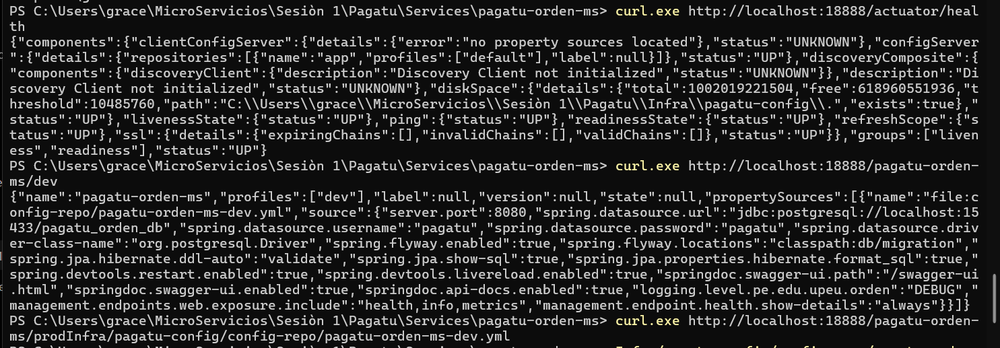
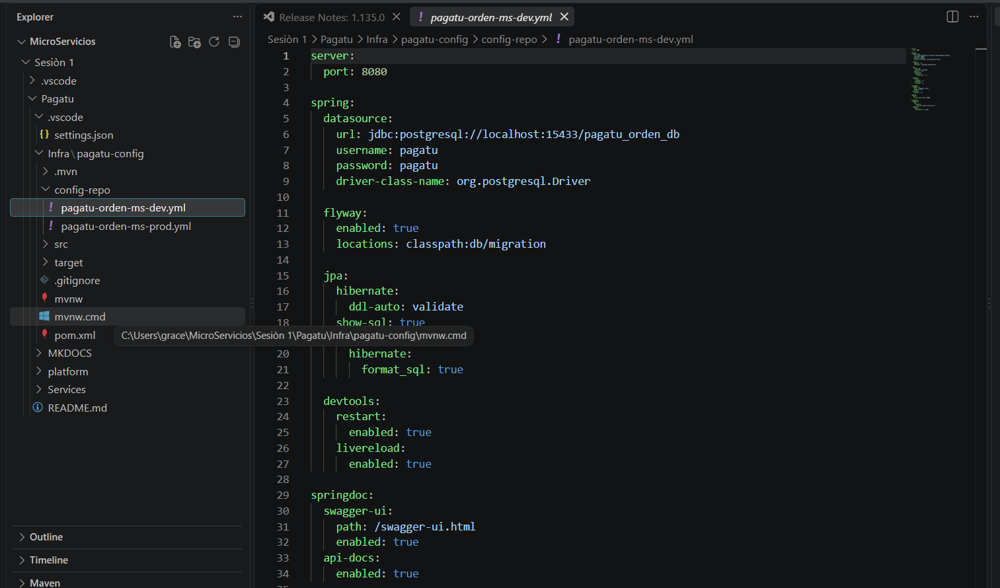
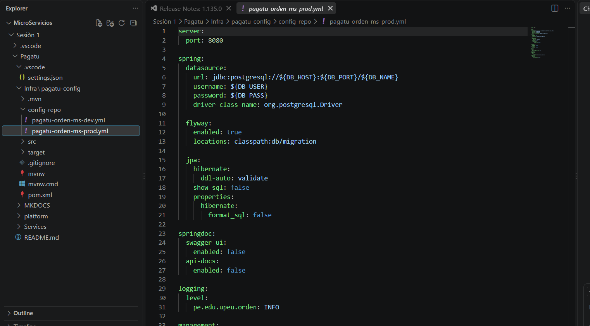
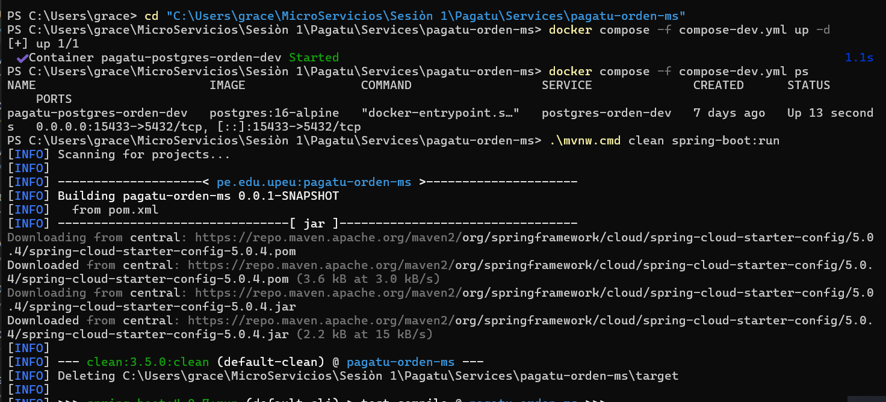
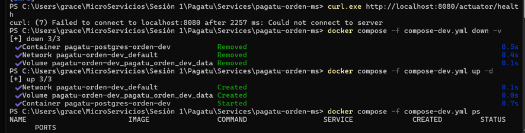
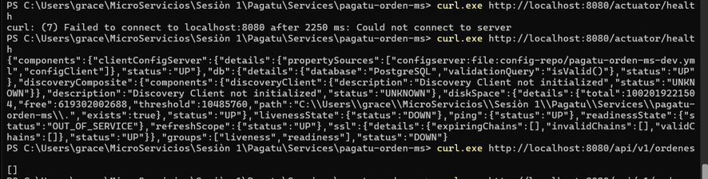
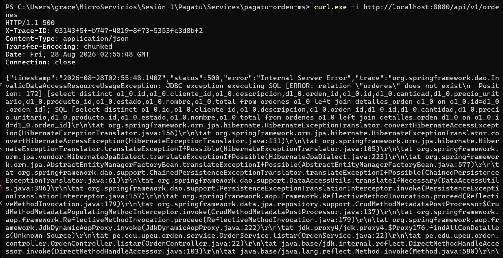

# S02 — Gestión Centralizada de Configuración y Ambientes

## Evidencia individual

En esta sesión se replicó el patrón de configuración centralizada sobre `pagatu-orden-ms`,
utilizando Spring Cloud Config para separar la configuración de DEV y PROD de la lógica
del microservicio.

---

## 1. Config Server operativo

`pagatu-config` se ejecuta en el puerto `18888` y expone la configuración del
microservicio por nombre de aplicación y perfil.

### Evidencia



En la evidencia se observa:

- consulta a `http://localhost:18888/actuator/health`;
- estado general `UP` del Config Server;
- consulta de `pagatu-orden-ms` con perfil `dev`;
- `propertySources` apuntando a `pagatu-orden-ms-dev.yml`;
- consulta posterior del perfil `prod`.

---

## 2. Configuración externa DEV

El archivo `pagatu-orden-ms-dev.yml` contiene la configuración destinada al ambiente
de desarrollo. Entre sus valores principales se encuentran:

- puerto `8080`;
- PostgreSQL local en `localhost:15433`;
- `show-sql: true`;
- Swagger/OpenAPI habilitado;
- logging `DEBUG`;
- detalles de health visibles.



---

## 3. Configuración externa PROD

El archivo `pagatu-orden-ms-prod.yml` utiliza parámetros apropiados para producción:

- datasource mediante variables de entorno;
- usuario y contraseña mediante `${DB_USER}` y `${DB_PASS}`;
- `show-sql: false`;
- Swagger/OpenAPI deshabilitado;
- logging `INFO`;
- menor exposición de información interna.



---

## 4. `pagatu-orden-ms` como Config Client

Se incorporó Spring Cloud Config Client al microservicio y se configuró el nombre:

```yaml
spring:
  application:
    name: pagatu-orden-ms
  profiles:
    active: dev
  config:
    import: "optional:configserver:${CONFIG_SERVER_URL:http://localhost:18888}"
```

Durante el arranque Maven descarga `spring-cloud-starter-config` y el servicio inicia
utilizando la configuración externa correspondiente a DEV.



---

## 5. Persistencia DEV y recreación de PostgreSQL

Durante las pruebas apareció una inconsistencia previa de Flyway. Para trabajar sobre
una base DEV limpia se eliminó y recreó el volumen local de PostgreSQL:

```powershell
docker compose -f compose-dev.yml down -v
docker compose -f compose-dev.yml up -d
```



Esta acción se realizó únicamente en el ambiente de práctica DEV.

---

## 6. Verificación del endpoint

En una de las ejecuciones, `GET /api/v1/ordenes` respondió con un arreglo vacío:

```json
[]
```

Esto indica que la petición llegó al endpoint y no existían registros para devolver en
ese momento.



### Hallazgo posterior

En una ejecución posterior, al consultar el mismo endpoint con `curl -i`, se obtuvo
`HTTP/1.1 500`. El mensaje relevante fue:

```text
relation "ordenes" does not exist
```



El hallazgo muestra una inconsistencia entre el esquema disponible en PostgreSQL y la
tabla que JPA intenta consultar. No corresponde a un fallo de Config Server: la
configuración externa ya había sido localizada correctamente. El problema se encuentra
en la capa de persistencia/migraciones y debe corregirse verificando la migración Flyway
que crea la tabla `ordenes`.

---

## 7. Comparación DEV vs PROD

| Propiedad | DEV | PROD |
|---|---|---|
| Base de datos | `localhost:15433/pagatu_orden_db` | Variables de entorno |
| Usuario/clave | valores locales | `${DB_USER}` / `${DB_PASS}` |
| `show-sql` | `true` | `false` |
| SQL formateado | `true` | `false` |
| Swagger | habilitado | deshabilitado |
| Logging | `DEBUG` | `INFO` |
| Health details | detallado | restringido |

### Valor externalizado

Un valor que antes pertenecía directamente a la configuración del microservicio era:

```text
jdbc:postgresql://localhost:15433/pagatu_orden_db
```

Ahora se encuentra en el `config-repo`, dentro de `pagatu-orden-ms-dev.yml`.

---

## 8. ¿Cómo separa Config Server el código y la configuración?

Config Server permite que `pagatu-orden-ms` conserve la lógica de negocio sin incorporar
directamente todos los valores de cada ambiente. El microservicio identifica su aplicación
y perfil, consulta a `pagatu-config` y recibe los parámetros correspondientes. De esta forma,
DEV y PROD pueden utilizar distintas conexiones, niveles de logging y herramientas de
diagnóstico sin modificar la lógica Java.

---

## 9. Error / hallazgo técnico

Durante la sesión aparecieron dos situaciones útiles para el diagnóstico:

1. **Checksum de Flyway distinto:** la migración registrada previamente en PostgreSQL
   no coincidía con el archivo local, por lo que Flyway detuvo el arranque.
2. **Tabla `ordenes` inexistente:** luego de recrear el entorno DEV, una consulta al endpoint
   mostró que el esquema de base de datos no contenía la relación que JPA esperaba.

Estos hallazgos muestran que Config Server puede estar funcionando correctamente aunque
exista un problema independiente en persistencia.

---

## 10. Reflexión técnica

Config Server reduce la duplicación de configuraciones cuando una solución crece a varios
microservicios e instancias. Los parámetros que dependen del ambiente dejan de estar
dispersos dentro de cada proyecto y pasan a administrarse desde una fuente central. Esto
facilita mantener diferencias controladas entre DEV y PROD y reduce inconsistencias.
También hace posible modificar parámetros operativos sin alterar la lógica de negocio.
La experiencia de esta sesión mostró además la importancia de separar los problemas:
la configuración remota puede funcionar correctamente mientras la persistencia presenta
errores propios de Flyway o del esquema de base de datos.

---

## 11. Comandos utilizados

```powershell
curl.exe http://localhost:18888/actuator/health
curl.exe http://localhost:18888/pagatu-orden-ms/dev
curl.exe http://localhost:18888/pagatu-orden-ms/prod
```

```powershell
docker compose -f compose-dev.yml up -d
.\mvnw.cmd clean spring-boot:run
```

```powershell
curl.exe -i http://localhost:8080/api/v1/ordenes
```
