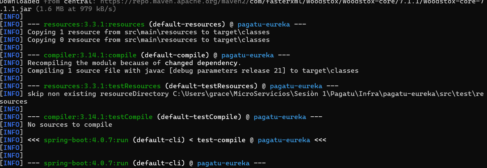
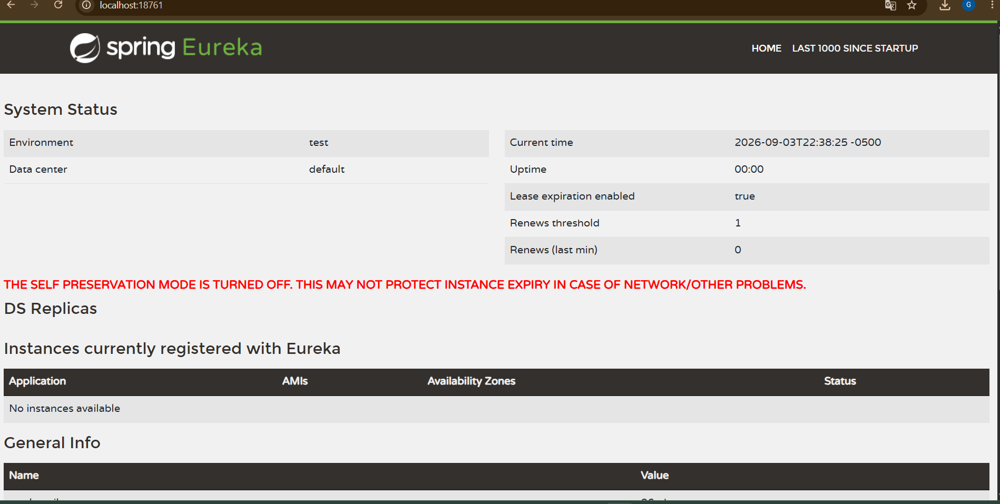
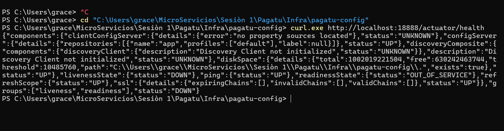
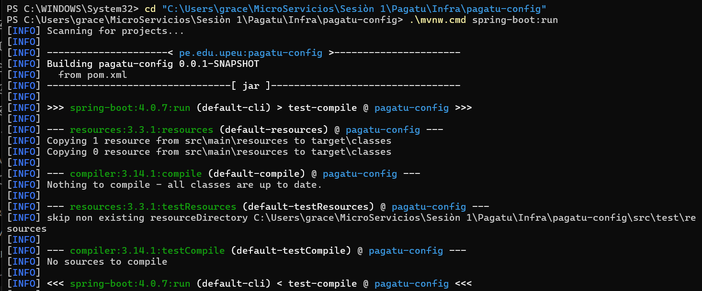

# S03 - Registro, Descubrimiento y Ejecución Concurrente de Servicios

## Datos del estudiante

- **Sesión:** S03 - Registro, Descubrimiento y Ejecución Concurrente de Servicios
- **Evidencia:** Individual
- **Microservicio aplicado:** `pagatu-orden-ms`
- **Repositorio:** [Tareas-Distribuidas](https://github.com/Stephmarc/Tareas-Distribuidas)
- **Rol o aporte realizado:** Configuración de `pagatu-eureka`, integración de `pagatu-orden-ms` como Eureka Client, verificación de Config Server y diagnóstico de ejecución concurrente.

---

## Objetivo

Implementar el patrón **Service Registry / Service Discovery** mediante Spring Cloud Netflix Eureka, de manera que los microservicios puedan registrarse mediante un nombre lógico y ser localizados sin mantener manualmente una lista fija de direcciones. La sesión continúa el trabajo de S02, donde `pagatu-orden-ms` ya fue migrado a Config Client.

### Arquitectura trabajada

```text
pagatu-config   :18888
       |
       v
pagatu-eureka   :18761
       ^
       |
pagatu-orden-ms
   |- instancia 1 :8080
   `- instancia 2 :8081
```

---

# Bloque 1 - `pagatu-eureka` operativo

Se incorporó el proyecto `pagatu-eureka` dentro de `Infra/pagatu-eureka` y se ejecutó como servidor de registro. El dashboard fue levantado en el puerto `18761`.

```text
http://localhost:18761
```

### Evidencia de ejecución de Eureka



La consola evidencia la compilación y ejecución del proyecto `pagatu-eureka` con Spring Boot.

### Dashboard de Eureka



El dashboard de Spring Eureka quedó disponible en `localhost:18761`. Durante la evidencia final el servidor se encontraba operativo; sin embargo, las instancias de `pagatu-orden-ms` no llegaron a mantenerse registradas de forma estable antes del cierre de la actividad. Esta situación se documenta como hallazgo técnico.

---

# Bloque 2 - `pagatu-orden-ms` como Config Client

Esta parte fue construida desde S02 y reutilizada en S03. `pagatu-orden-ms` mantiene una configuración local mínima y obtiene su configuración del Config Server.

### Config Server

```text
http://localhost:18888
```



También se verificó el arranque del proyecto `pagatu-config`:



La consulta realizada fue:

```powershell
curl.exe http://localhost:18888/pagatu-orden-ms/dev
```

La respuesta confirmó que el Config Server entregaba el archivo `pagatu-orden-ms-dev.yml` y propiedades como:

```yaml
server:
  port: 8080

spring:
  datasource:
    url: jdbc:postgresql://localhost:15433/pagatu_orden_db
    username: pagatu
    password: pagatu

eureka:
  instance:
    hostname: localhost
    instance-id: ${spring.application.name}:${server.port}
  client:
    service-url:
      defaultZone: http://localhost:18761/eureka
```

Con ello se comprobó que la configuración de DEV se encuentra externalizada y que `pagatu-orden-ms` obtiene desde Config Server tanto la configuración de base de datos como la dirección de Eureka.

---

# Bloque 3 - Registro de `pagatu-orden-ms` y múltiples instancias

Se agregó en `pagatu-orden-ms` la dependencia Eureka Client:

```xml
<dependency>
    <groupId>org.springframework.cloud</groupId>
    <artifactId>spring-cloud-starter-netflix-eureka-client</artifactId>
</dependency>
```

Para identificar cada instancia se configuró:

```yaml
eureka:
  instance:
    instance-id: ${spring.application.name}:${server.port}
  client:
    service-url:
      defaultZone: http://localhost:18761/eureka
```

La primera instancia se trabajó en el puerto `8080` y la segunda debía ejecutarse con override en `8081`:

```powershell
.\mvnw.cmd spring-boot:run "-Dspring-boot.run.arguments=--server.port=8081"
```

### Resultado obtenido

Durante la ejecución se verificó que PostgreSQL estaba activo y que el endpoint de salud de una instancia llegó a responder:

```json
{"groups":["liveness","readiness"],"status":"UP"}
```

Sin embargo, en la ejecución final se produjeron conflictos entre procesos ya abiertos, disponibilidad del Config Server y puertos ocupados. Por ese motivo las dos instancias no llegaron a quedar visibles simultáneamente en el dashboard antes del cierre de la actividad.

La guía contempla que, si no se logra evidenciar las dos instancias, se justifique explícitamente la causa. En este caso, el diagnóstico realizado permitió identificar problemas concretos de orden de arranque y colisión de puertos.

---

# Bloque 4 - Comprensión del patrón Service Registry

Antes de Eureka, un componente consumidor tendría que conocer de forma explícita direcciones como `localhost:8080` y `localhost:8081`. Esto obliga a mantener manualmente una lista de hosts y puertos y actualizarla cada vez que una instancia se agrega, reinicia o deja de estar disponible.

Con Eureka, cada instancia se registra usando el mismo nombre lógico, por ejemplo `pagatu-orden-ms`. Un componente que use descubrimiento consulta el registro por ese nombre y Eureka le informa cuáles son las instancias disponibles y dónde se encuentran. Los puertos continúan existiendo y pueden seguir siendo fijos, pero ya no tienen que estar escritos a mano en cada consumidor. Este mecanismo es la base que permitirá que en S04 el Gateway descubra las instancias y pueda distribuir tráfico entre ellas.

---

# Error o hallazgo técnico

Durante la práctica se presentaron varios problemas de ejecución concurrente. Primero, `pagatu-orden-ms` no pudo obtener su configuración cuando `pagatu-config` dejó de estar disponible en el puerto `18888`, lo que provocó un error de configuración del `DataSource`. Después se detectaron conflictos por puertos ocupados: una instancia previa utilizaba `8080` y un intento adicional de Eureka encontró ocupado `18761`.

También se observó que Eureka podía intentar usar su configuración por defecto si no recibía correctamente las propiedades esperadas. La corrección consistió en verificar cada servicio de forma independiente, controlar los procesos activos y respetar el orden de arranque: Config Server, Eureka Server, PostgreSQL y finalmente las instancias del microservicio.

Este hallazgo mostró que en un sistema distribuido no basta con que cada proyecto compile; los servicios deben estar disponibles al mismo tiempo, en los puertos correctos y con una configuración coherente entre ellos.

---

# Reflexión técnica

El registro y descubrimiento de servicios es un prerrequisito para el Gateway porque permite que este encuentre las instancias de un microservicio sin tener una lista fija de direcciones. Eureka mantiene la información de las instancias activas y las identifica mediante un nombre lógico. Cuando existen varias instancias del mismo servicio, el Gateway puede consultar ese registro y decidir a cuál enviar cada solicitud. De esta forma se puede implementar balanceo de carga sin modificar manualmente la configuración cada vez que aparece o desaparece una instancia. Esta sesión también mostró la importancia de mantener disponibles simultáneamente los componentes de infraestructura. En S04, el Gateway podrá apoyarse en este registro para convertirse en el punto único de acceso al sistema.

---

# Preguntas de defensa

**1. ¿Por qué `pagatu-eureka` no se registra a sí mismo?**  
Porque cumple el rol de servidor de registro. En esta arquitectura local no necesita actuar como cliente de otro Eureka, por eso `register-with-eureka` y `fetch-registry` se desactivan.

**2. ¿Qué pasa si se levanta una segunda instancia sin cambiar el puerto?**  
La segunda instancia falla porque el puerto `8080` ya está siendo utilizado por la primera. Por eso se debe usar un puerto diferente, como `8081`.

**3. ¿Cómo se verifica correctamente que `pagatu-orden-ms` está registrado?**  
No basta con comprobar que el proceso arrancó. Se debe ingresar al dashboard de Eureka y verificar que el nombre lógico `PAGATU-ORDEN-MS` aparece con su instancia y estado `UP`.

**4. ¿Qué ocurre si una instancia deja de enviar heartbeat?**  
Eureka deja de recibir sus renovaciones y, después del intervalo correspondiente, la instancia deja de considerarse disponible en el registro.

**5. ¿Por qué `spring.application.name` también es importante desde S02?**  
Porque Config Server utiliza ese nombre para localizar la configuración del servicio y Eureka lo utiliza como nombre lógico para registrar y descubrir sus instancias.

**6. ¿Qué otro componente puede consultar Eureka?**  
Un API Gateway o una herramienta de observabilidad puede usar el registro para descubrir instancias sin mantener direcciones escritas manualmente.

---

# Anexo - Feedback de la sesión

**1. ¿Cuál es el aprendizaje más importante que te llevas de la clase de hoy?**  
Comprendí que Eureka permite registrar y descubrir microservicios por un nombre lógico, evitando depender de una lista fija de direcciones y puertos.

**2. ¿Qué punto de la clase te resultó más confuso o te dejó con dudas?**  
La parte más complicada fue mantener al mismo tiempo Config Server, Eureka, PostgreSQL y las distintas instancias sin generar conflictos de puertos.

**3. ¿Tienes alguna pregunta que te gustaría que sea respondida la siguiente clase?**  
Me gustaría ver con más detalle cómo el Gateway selecciona automáticamente una instancia registrada en Eureka cuando existen varias disponibles.

**4. Nivel de comprensión:**  
**Más o menos.** Entendí la idea general y el funcionamiento de Eureka, pero necesito reforzar la ejecución concurrente y el diagnóstico de registro.

**5. ¿Cómo puedo ayudarte a comprender mejor el tema?**  
Con un ejemplo completo de arranque en orden de Config Server, Eureka Server, dos instancias de un microservicio y la verificación final en el dashboard.

**6. Autoevaluación de participación y esfuerzo:**  
**Muy comprometido/a:** me esforcé en diagnosticar los errores y completar la evidencia técnica de la sesión.

**7. Satisfacción con la clase:**  
**8/10**.

---

## Conclusión

En S03 se incorporó `pagatu-eureka` como servidor de registro y se preparó `pagatu-orden-ms` para funcionar como Eureka Client reutilizando la configuración centralizada construida en S02. Se logró verificar Config Server, Eureka Server, PostgreSQL y el health del microservicio. La ejecución concurrente permitió detectar problemas reales de dependencia entre servicios y conflictos de puertos. Aunque las dos instancias no quedaron visibles simultáneamente en el dashboard durante la evidencia final, el diagnóstico realizado permitió comprender cómo deben coordinarse configuración, registro y ejecución de instancias para continuar con Gateway y balanceo de carga en S04.
