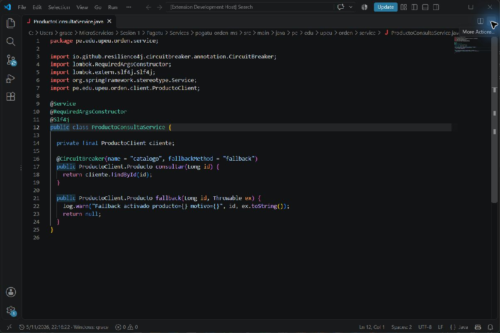
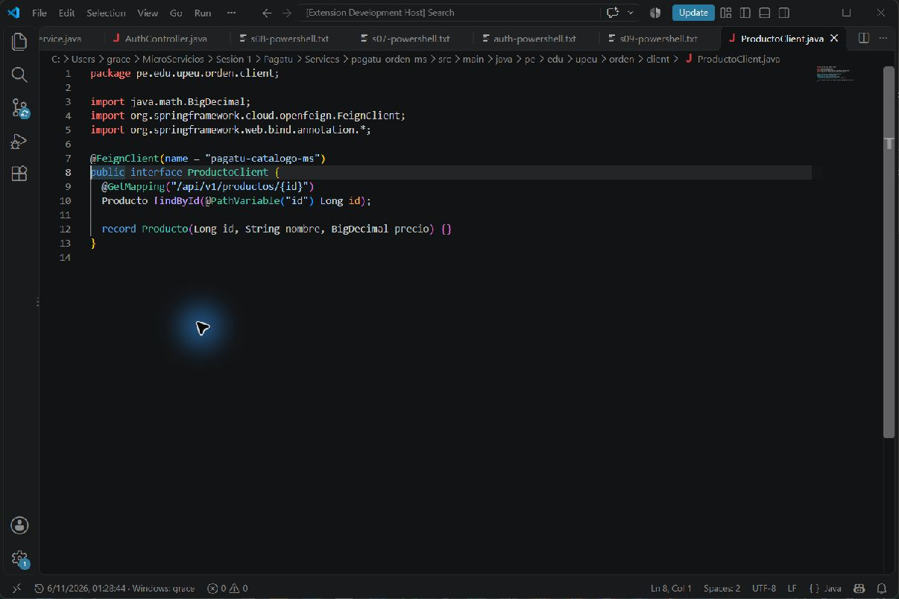
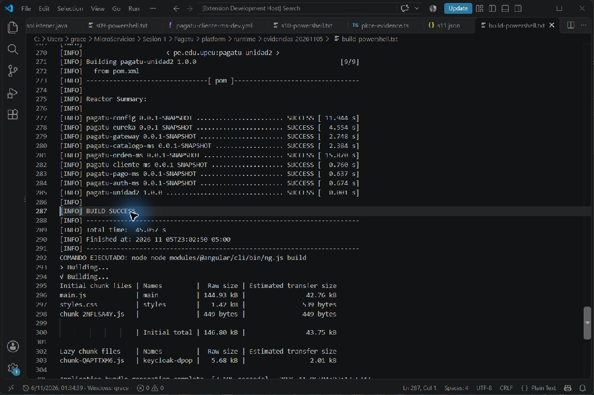
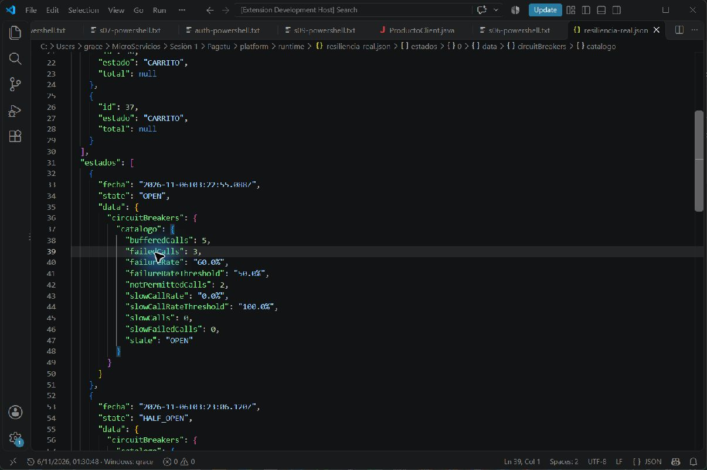
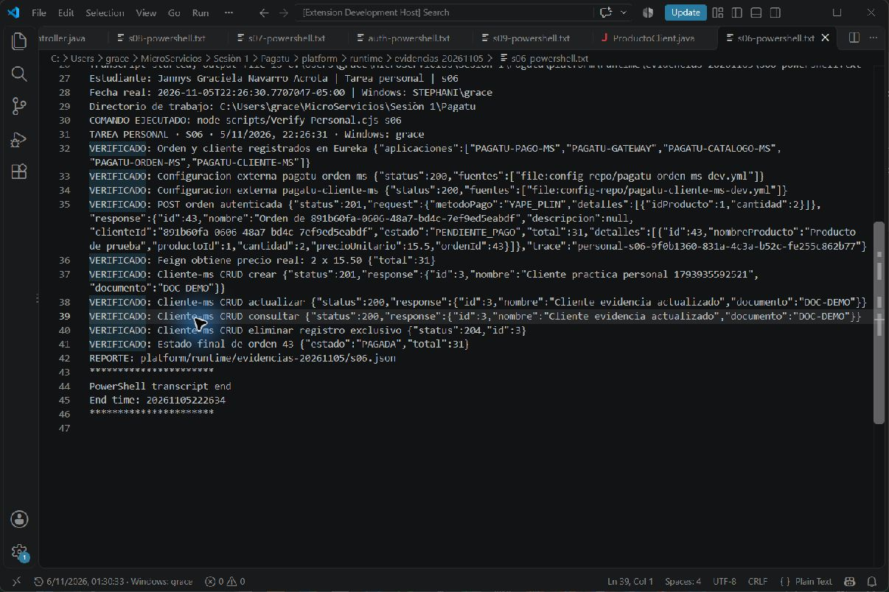

# S06 · Comunicación síncrona resiliente entre servicios

**Estudiante:** Jannys Graciela Navarro Acrota

**Equipo de referencia:** 09 · Casa o Nada

**Entrega:** tarea personal sobre la base Pagatu; implementación individual y verificación local.

**Repositorio:** [https://github.com/Stephmarc/Tareas-Distribuidas](https://github.com/Stephmarc/Tareas-Distribuidas)

**Guía docente:** [Actividad y estructura](https://262dist.github.io/pagatu/sesiones/S06_Comunicacion_Sincrona_Resiliente/#4-crea-actividad-autonoma)

[Descargar informe PDF](S06_Equipo09_NavarroJannys.pdf)

## Qué se ejecutó

Pruebas realizadas el 5 de noviembre de 2026, hora de Lima. Las fechas ISO de los reportes usan UTC y por eso pueden indicar 6 de noviembre. Los IDs, estados y códigos que siguen proceden de las respuestas originales, no de resultados inventados.

Capturas complementarias de VS Code tomadas el 6 de noviembre de 2026, con reloj real y usuario Windows visibles. Muestran código y archivos originales de las pruebas del 5 de noviembre; visualizar un transcript no constituye una nueva ejecución.

## 1. Orden con configuración externa y Eureka

El servicio de órdenes obtiene su perfil dev del Config Server en 18888 y se registra en Eureka 18761. La prueba consulta ambos endpoints reales; no deduce el registro a partir de que compile.

## 2. Comunicación Feign

POST /api/v1/ordenes envía únicamente producto 1 y cantidad 2. ProductoClient usa el nombre lógico pagatu-catalogo-ms. El precio unitario leído es 15.50 y el total calculado por el servidor es 31.00.

## 3. Circuit Breaker con catálogo detenido

El script detuvo únicamente el PID verificado del catálogo personal. Se guardaron los carritos 33, 34, 35, 36, 37 con total null. El endpoint del Circuit Breaker registró OPEN, HALF_OPEN y CLOSED tras recuperar catálogo. No se simula una caída cambiando un número de producto.

## 4. Cliente autónomo

Cliente tiene entidad, repositorio, servicio y controlador propios, PostgreSQL separado, Config Server y Eureka. El CRUD real respondió crear 201, actualizar 200, consultar 200 y eliminar 204 sobre un registro exclusivo de prueba.

## Código incorporado y su función

### `ProductoClient.java`

[Ver archivo y líneas en GitHub](https://github.com/Stephmarc/Tareas-Distribuidas/blob/main/Services/pagatu-orden-ms/src/main/java/pe/edu/upeu/orden/client/ProductoClient.java#L1)

```java
  1 package pe.edu.upeu.orden.client;
  2
  3 import java.math.BigDecimal;
  4 import org.springframework.cloud.openfeign.FeignClient;
  5 import org.springframework.web.bind.annotation.*;
  6
  7 @FeignClient(name = "pagatu-catalogo-ms")
  8 public interface ProductoClient {
  9   @GetMapping("/api/v1/productos/{id}")
 10   Producto findById(@PathVariable("id") Long id);
 11
 12   record Producto(Long id, String nombre, BigDecimal precio) {}
 13 }
```

### `ProductoConsultaService.java`

[Ver archivo y líneas en GitHub](https://github.com/Stephmarc/Tareas-Distribuidas/blob/main/Services/pagatu-orden-ms/src/main/java/pe/edu/upeu/orden/service/ProductoConsultaService.java#L11)

```java
 11 @Slf4j
 12 public class ProductoConsultaService {
 13
 14   private final ProductoClient cliente;
 15
 16   @CircuitBreaker(name = "catalogo", fallbackMethod = "fallback")
 17   public ProductoClient.Producto consultar(Long id) {
 18     return cliente.findById(id);
 19   }
 20
 21   public ProductoClient.Producto fallback(Long id, Throwable ex) {
 22     log.warn("Fallback activado producto={} motivo={}", id, ex.toString());
 23     return null;
 24   }
 25 }
```

### `ClienteController.java`

[Ver archivo y líneas en GitHub](https://github.com/Stephmarc/Tareas-Distribuidas/blob/main/Services/pagatu-cliente-ms/src/main/java/pe/edu/upeu/cliente/ClienteController.java#L20)

```java
 20     this.s = s;
 21   }
 22
 23   private Respuesta dto(Cliente c) {
 24     return new Respuesta(c.id, c.nombre, c.documento);
 25   }
 26
 27   @GetMapping
 28   public List<Respuesta> listar() {
 29     return s.listar().stream().map(this::dto).toList();
 30   }
 31
 32   @GetMapping("/{id}")
 33   public Respuesta obtener(@PathVariable Long id) {
 34     return dto(s.obtener(id));
 35   }
 36
 37   @PostMapping
 38   @ResponseStatus(HttpStatus.CREATED)
 39   public Respuesta crear(@Valid @RequestBody Datos d) {
 40     return dto(s.guardar(null, d));
 41   }
 42
 43   @PutMapping("/{id}")
 44   public Respuesta actualizar(
 45     @PathVariable Long id,
 46     @Valid @RequestBody Datos d
 47   ) {
 48     return dto(s.guardar(id, d));
```

## Comandos ejecutados y resultados originales

Los `.txt` son transcripts originales de PowerShell. Las capturas que los muestran en VS Code son vistas del archivo original, no fotografías de una ventana CMD. Los JSON conservan requests, respuestas, estados y trazas.

```powershell
& ".\scripts\Run-PersonalEvidence.ps1" -Sesion s06
```

- [Salida original: s06.json](assets/s06.json)
- [Salida original: s06-powershell.txt](assets/s06-powershell.txt)
- [Salida original: resiliencia-powershell.txt](assets/resiliencia-powershell.txt)
- [Salida original: resiliencia-real.json](assets/resiliencia-real.json)

### Respuesta original completa

```json
{
  "sesion": "s06",
  "fecha": "2026-11-06T03:26:31.488Z",
  "usuarioWindows": "grace",
  "estudiante": "Jannys Graciela Navarro Acrota",
  "pasos": [
    {
      "prueba": "Orden y cliente registrados en Eureka",
      "aplicaciones": [
        "PAGATU-PAGO-MS",
        "PAGATU-GATEWAY",
        "PAGATU-CATALOGO-MS",
        "PAGATU-ORDEN-MS",
        "PAGATU-CLIENTE-MS"
      ]
    },
    {
      "prueba": "Configuracion externa pagatu-orden-ms",
      "status": 200,
      "fuentes": [
        "file:config-repo/pagatu-orden-ms-dev.yml"
      ]
    },
    {
      "prueba": "Configuracion externa pagatu-cliente-ms",
      "status": 200,
      "fuentes": [
        "file:config-repo/pagatu-cliente-ms-dev.yml"
      ]
    },
    {
      "prueba": "POST orden autenticada",
      "status": 201,
      "request": {
        "metodoPago": "YAPE_PLIN",
        "detalles": [
          {
            "idProducto": 1,
            "cantidad": 2
          }
        ]
      },
      "response": {
        "id": 43,
        "nombre": "Orden de 891b60fa-0606-48a7-bd4c-7ef9ed5eabdf",
        "descripcion": null,
        "clienteId": "891b60fa-0606-48a7-bd4c-7ef9ed5eabdf",
        "estado": "PENDIENTE_PAGO",
        "total": 31,
        "detalles": [
          {
            "id": 43,
            "nombreProducto": "Producto de prueba",
            "productoId": 1,
            "cantidad": 2,
            "precioUnitario": 15.5,
            "ordenId": 43
          }
        ]
      },
      "trace": "personal-s06-9f0b1360-831a-4c3a-b52c-fe255c862b77"
    },
    {
      "prueba": "Feign obtiene precio real: 2 x 15.50",
      "total": 31
    },
    {
      "prueba": "Cliente-ms CRUD crear",
      "status": 201,
      "response": {
        "id": 3,
        "nombre": "Cliente practica personal 1793935592521",
        "documento": "DOC-DEMO"
      }
    },
    {
      "prueba": "Cliente-ms CRUD actualizar",
      "status": 200,
      "response": {
        "id": 3,
        "nombre": "Cliente evidencia actualizado",
        "documento": "DOC-DEMO"
      }
    },
    {
      "prueba": "Cliente-ms CRUD consultar",
      "status": 200,
      "response": {
        "id": 3,
        "nombre": "Cliente evidencia actualizado",
        "documento": "DOC-DEMO"
      }
    },
    {
      "prueba": "Cliente-ms CRUD eliminar registro exclusivo",
      "status": 204,
      "id": 3
    },
    {
      "prueba": "Estado final de orden 43",
      "estado": "PAGADA",
      "total": 31
    }
  ],
  "resultado": "APROBADO"
}
```

```json
{
  "fecha": "2026-11-06T03:22:54.192Z",
  "tipoFallo": "Proceso de catálogo detenido y recuperado desde PowerShell",
  "carritos": [
    {
      "id": 33,
      "estado": "CARRITO",
      "total": null
    },
    {
      "id": 34,
      "estado": "CARRITO",
      "total": null
    },
    {
      "id": 35,
      "estado": "CARRITO",
      "total": null
    },
    {
      "id": 36,
      "estado": "CARRITO",
      "total": null
    },
    {
      "id": 37,
      "estado": "CARRITO",
      "total": null
    }
  ],
  "estados": [
    {
      "fecha": "2026-11-06T03:22:55.088Z",
      "state": "OPEN",
      "data": {
        "circuitBreakers": {
          "catalogo": {
            "bufferedCalls": 5,
            "failedCalls": 3,
            "failureRate": "60.0%",
            "failureRateThreshold": "50.0%",
            "notPermittedCalls": 2,
            "slowCallRate": "0.0%",
            "slowCallRateThreshold": "100.0%",
            "slowCalls": 0,
            "slowFailedCalls": 0,
            "state": "OPEN"
          }
        }
      }
    },
    {
      "fecha": "2026-11-06T03:23:06.120Z",
      "state": "HALF_OPEN",
      "data": {
        "circuitBreakers": {
          "catalogo": {
            "bufferedCalls": 0,
            "failedCalls": 0,
            "failureRate": "-1.0%",
            "failureRateThreshold": "50.0%",
            "notPermittedCalls": 0,
            "slowCallRate": "-1.0%",
            "slowCallRateThreshold": "100.0%",
            "slowCalls": 0,
            "slowFailedCalls": 0,
            "state": "HALF_OPEN"
          }
        }
      }
    },
    {
      "fecha": "2026-11-06T03:23:39.100Z",
      "state": "CLOSED",
      "data": {
        "circuitBreakers": {
          "catalogo": {
            "bufferedCalls": 0,
            "failedCalls": 0,
            "failureRate": "-1.0%",
            "failureRateThreshold": "50.0%",
            "notPermittedCalls": 0,
            "slowCallRate": "-1.0%",
            "slowCallRateThreshold": "100.0%",
            "slowCalls": 0,
            "slowFailedCalls": 0,
            "state": "CLOSED"
          }
        }
      }
    }
  ],
  "recuperacion": [
    {
      "id": 38,
      "estado": "PENDIENTE_PAGO",
      "total": 15.5
    },
    {
      "id": 39,
      "estado": "PENDIENTE_PAGO",
      "total": 15.5
    }
  ],
  "resultado": "APROBADO"
}
```

## Capturas reales

Las imágenes se conservan completas, sin superponer resultados ni modificar fechas. El reloj de VS Code es una extensión local que lee la hora del equipo; el modo `?evidencia=1` de Angular muestra la hora real y el usuario autenticado. Las vistas web de Kafka/Grafana son complementarias y no incluyen por sí solas el reloj de Windows.



*S06 circuit breaker codigo. Captura íntegra de la vista real; consultar la salida original para los detalles completos.*



*Código real: ProductoClient declara el nombre lógico pagatu-catalogo-ms y la consulta del precio por Feign.. Captura íntegra de la vista real; consultar la salida original para los detalles completos.*



*Transcript original: nueve módulos del reactor en SUCCESS, BUILD SUCCESS y comando de compilación Angular. Ejecución del 5 de noviembre, captura del 6 de noviembre.. Captura íntegra de la vista real; consultar la salida original para los detalles completos.*



*Reporte original de catálogo detenido: CARRITO con total null, OPEN y HALF_OPEN. El archivo completo conserva también la recuperación CLOSED.. Captura íntegra de la vista real; consultar la salida original para los detalles completos.*



*Transcript original de PowerShell: comando S06, Eureka y Config Server, orden 43 por 31.00 y CRUD de cliente 201/200/200/204.. Captura íntegra de la vista real; consultar la salida original para los detalles completos.*

## Error o hallazgo real

Se detectó el riesgo de reutilización de PID al reiniciar servicios: un PID guardado puede pertenecer a otro programa. Los scripts ahora verifican java.exe y la ruta del módulo antes de detenerlo o considerarlo iniciado.

## Reflexión técnica

Un timeout limita cuánto espera una llamada individual.
Aumentarlo hace que cada petición bloqueada retenga recursos más tiempo.
El Circuit Breaker observa fallos y abre el circuito al superar el umbral.
Mientras está OPEN evita insistir contra una dependencia que sigue caída.
HALF_OPEN permite comprobar su recuperación con pocas llamadas.
Guardar CARRITO conserva la intención sin inventar precios ni confirmar un pago.
Cada servicio posee su base para evolucionar sin tablas compartidas entre dominios.

## Anexo · Feedback de la sesión

**Lo completa la estudiante.** Estas respuestas describen tu experiencia en clase; no se inventan ni se califica tu esfuerzo automáticamente. En el PDF hay campos editables.

1. ¿Cuál es el aprendizaje más importante que te llevas de la clase de hoy?

   Respuesta: ______________________________

2. ¿Qué punto de la clase te resultó más confuso o te dejó con dudas?

   Respuesta: ______________________________

3. ¿Tienes alguna pregunta para la siguiente clase?

   Respuesta: ______________________________

4. Nivel de comprensión: Entendido / Más o menos / Necesito ayuda.

   Respuesta: ______________________________

5. ¿Cómo puede ayudarte el docente a comprender mejor el tema?

   Respuesta: ______________________________

6. Participación: Muy comprometido/a / Comprometido/a / Poco comprometido/a.

   Respuesta: ______________________________

7. Satisfacción con la clase: 1 a 10.

   Respuesta: ______________________________

## Alcance y límites

Este informe documenta la tarea personal sobre Pagatu. La guía del docente también exige adaptar actividades al Proyecto Sello del equipo: la entrega grupal CASAS es independiente y no se presenta aquí como si fuera esta implementación. No se atribuye una defensa oral ni un resultado de evaluación que no se haya realizado.
