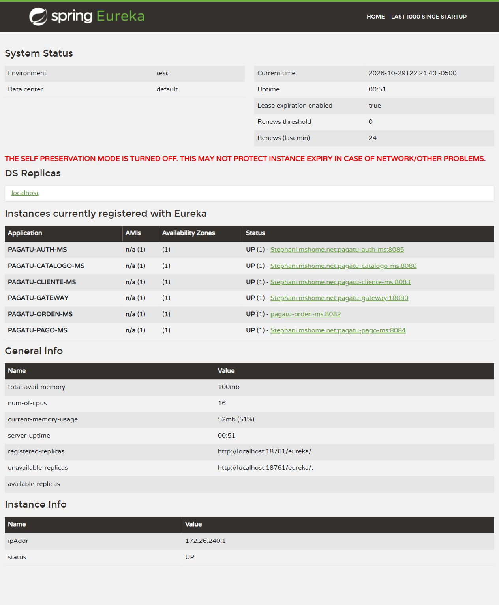

# S06 · Comunicación síncrona resiliente

**Jannys Graciela Navarro Acrota** · Tarea personal de Sistemas Distribuidos.

Grupo de referencia: Casa o Nada. Esta documentación corresponde al avance individual, no al informe grupal oficial.

## Trabajo realizado

Se conectó órdenes con catálogo mediante Feign y Eureka. El precio se consulta al catálogo; el usuario no puede fijar el total de la orden.

## Prueba realizada

- Dos unidades de S/ 15.50 produjeron un total de **S/ 31.00**.
- Se detuvo realmente catálogo: las órdenes **19 a 23** se guardaron en **CARRITO**, con total **null**.
- Actuator confirmó **OPEN → HALF_OPEN → CLOSED**. Al recuperar catálogo, las órdenes 24 y 25 volvieron a obtener el precio.

[Reporte real del circuito](../evidencias/resiliencia-real.json).

La captura muestra el registro de los servicios durante las pruebas, incluido el servicio temporal de autenticación de S07.

## Explicación breve

El Circuit Breaker evita insistir en una dependencia que falla. El fallback conserva el carrito sin inventar precios; después se comprueba la recuperación con pocas llamadas.
