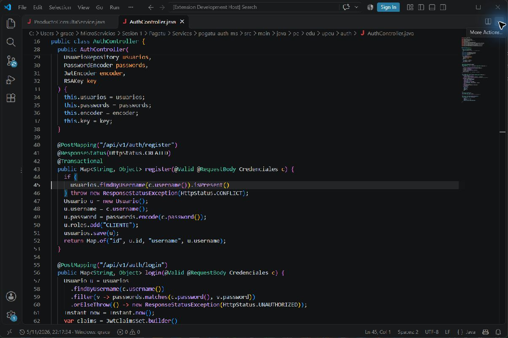
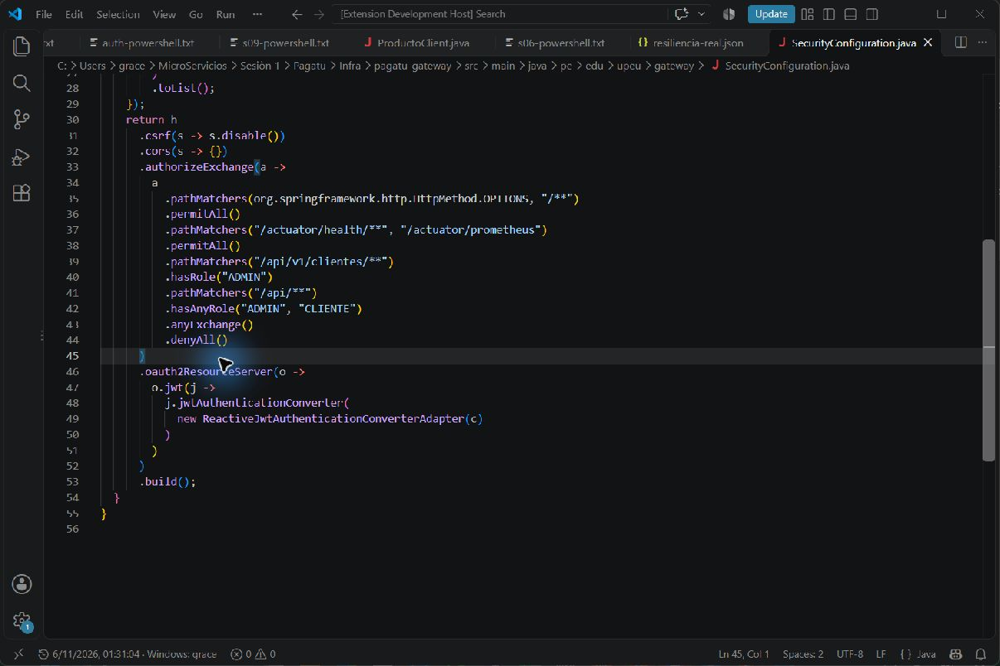
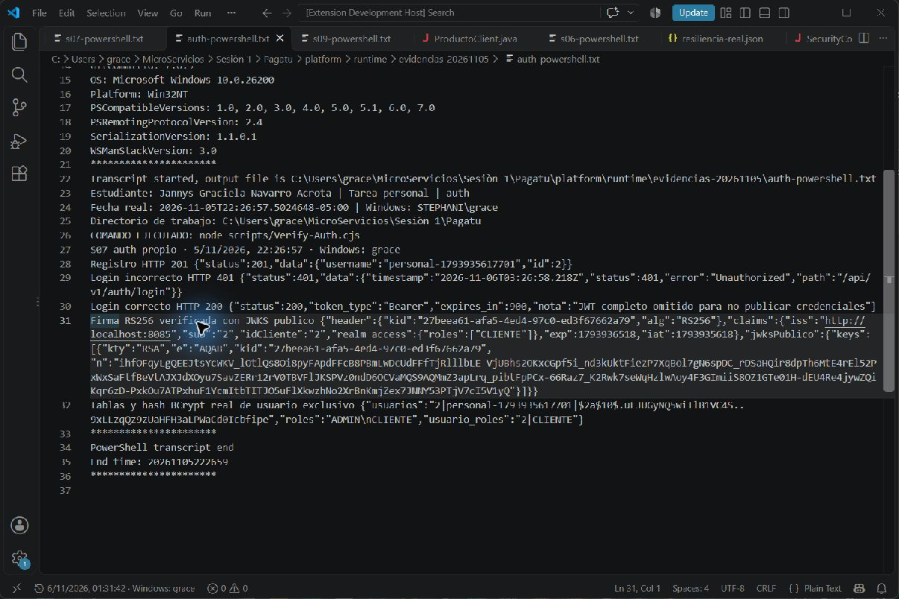
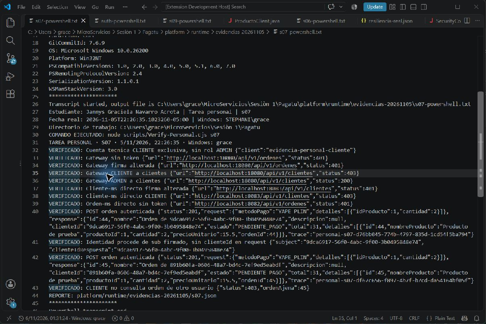

# S07 · Seguridad distribuida y control de acceso

**Estudiante:** Jannys Graciela Navarro Acrota

**Equipo de referencia:** 09 · Casa o Nada

**Entrega:** tarea personal sobre la base Pagatu; implementación individual y verificación local.

**Repositorio:** [https://github.com/Stephmarc/Tareas-Distribuidas](https://github.com/Stephmarc/Tareas-Distribuidas)

**Guía docente:** [Actividad y estructura](https://262dist.github.io/pagatu/sesiones/S07_Seguridad_Distribuida_Control_Acceso/#4-crea-actividad-autonoma)

[Descargar informe PDF](S07_Equipo09_NavarroJannys.pdf)

## Qué se ejecutó

Pruebas realizadas el 5 de noviembre de 2026, hora de Lima. Las fechas ISO de los reportes usan UTC y por eso pueden indicar 6 de noviembre. Los IDs, estados y códigos que siguen proceden de las respuestas originales, no de resultados inventados.

Capturas complementarias de VS Code tomadas el 6 de noviembre de 2026, con reloj real y usuario Windows visibles. Muestran código y archivos originales de las pruebas del 5 de noviembre; visualizar un transcript no constituye una nueva ejecución.

## 1. Auth propio construido

Se arrancó el perfil s07 y PostgreSQL auth. El registro real respondió 201, el login con contraseña incorrecta 401 y el correcto 200. La firma RS256 se verificó con el JWKS público. Se consultaron usuarios, roles y usuario_roles y se comprobó el hash BCrypt del usuario de prueba. El JWT íntegro se conserva solo en memoria y no se publica.

## 2. Gateway Resource Server

La matriz probada con el proveedor final Keycloak devuelve 401 sin token, 401 con firma alterada, 403 al CLIENTE que lista clientes y 200 al ADMIN. Estas verificaciones pertenecen a la evolución final S07b; no se afirma que un token de auth propio y uno de Keycloak compartan emisor. También se repitieron estos casos usando el JWT de auth propio con los Resource Servers reiniciados temporalmente al issuer 8085: 401, 401, 403 y 200, además de crear la orden 52 con clienteId 3 y total 31.00. Al finalizar se restauró Keycloak en todos ellos.

## 3. Órdenes e identidad firmada

El request no declara clienteId. La respuesta toma clienteId del sub firmado. La llamada directa a órdenes sin JWT devuelve 401 y consultar una orden ajena devuelve 403.

## 4. Cliente protegido

El servicio cliente valida JWT por su cuenta. La ruta de clientes existe en Gateway. Se probaron ADMIN permitido, CLIENTE denegado y token alterado directamente al puerto 8083. Todas las operaciones CRUD de clientes son administrativas en esta implementación; no existe una ruta de perfil propio.

### Matriz de acceso

| Recurso | Sin JWT / alterado | CLIENTE | ADMIN |
|---|---|---|---|
| Gateway clientes (CRUD) | 401 | 403 | Permitido |
| Cliente directo 8083 | 401 | 403 | Permitido |
| Orden propia | 401 | Permitido | Permitido |
| Orden ajena | 401 | 403 | Permitido |

## Código incorporado y su función

### `AuthController.java`

[Ver archivo y líneas en GitHub](https://github.com/Stephmarc/Tareas-Distribuidas/blob/main/Services/pagatu-auth-ms/src/main/java/pe/edu/upeu/auth/AuthController.java#L40)

```java
 40   @PostMapping("/api/v1/auth/register")
 41   @ResponseStatus(HttpStatus.CREATED)
 42   @Transactional
 43   public Map<String, Object> register(@Valid @RequestBody Credenciales c) {
 44     if (
 45       usuarios.findByUsername(c.username()).isPresent()
 46     ) throw new ResponseStatusException(HttpStatus.CONFLICT);
 47     Usuario u = new Usuario();
 48     u.username = c.username();
 49     u.password = passwords.encode(c.password());
 50     u.roles.add("CLIENTE");
 51     usuarios.save(u);
 52     return Map.of("id", u.id, "username", u.username);
 53   }
 54
 55   @PostMapping("/api/v1/auth/login")
 56   public Map<String, Object> login(@Valid @RequestBody Credenciales c) {
 57     Usuario u = usuarios
 58       .findByUsername(c.username())
 59       .filter(v -> passwords.matches(c.password(), v.password))
 60       .orElseThrow(() -> new ResponseStatusException(HttpStatus.UNAUTHORIZED));
 61     Instant now = Instant.now();
 62     var claims = JwtClaimsSet.builder()
 63       .issuer("http://localhost:8085")
 64       .subject(u.id.toString())
 65       .issuedAt(now)
 66       .expiresAt(now.plusSeconds(900))
 67       .claim("idCliente", u.id.toString())
 68       .claim("realm_access", Map.of("roles", u.roles))
 69       .build();
 70     String token = encoder
 71       .encode(JwtEncoderParameters.from(claims))
 72       .getTokenValue();
 73     return Map.of(
 74       "access_token",
 75       token,
 76       "token_type",
 77       "Bearer",
 78       "expires_in",
 79       900
 80     );
 81   }
 82
 83   @GetMapping("/oauth2/jwks")
 84   public Map<String, Object> jwks() {
 85     return new JWKSet(key.toPublicJWK()).toJSONObject();
 86   }
 87
 88   @GetMapping("/.well-known/openid-configuration")
 89   public Map<String, Object> discovery() {
 90     return Map.of(
 91       "issuer",
 92       "http://localhost:8085",
 93       "jwks_uri",
 94       "http://localhost:8085/oauth2/jwks"
 95     );
 96   }
 97 }
```

### `SecurityConfiguration.java`

[Ver archivo y líneas en GitHub](https://github.com/Stephmarc/Tareas-Distribuidas/blob/main/Infra/pagatu-gateway/src/main/java/pe/edu/upeu/gateway/SecurityConfiguration.java#L15)

```java
 15     JwtAuthenticationConverter c = new JwtAuthenticationConverter();
 16     c.setJwtGrantedAuthoritiesConverter(jwt -> {
 17       Map<String, Object> a = jwt.getClaim("realm_access");
 18       List<?> roles =
 19         a == null ? List.of() : (List<?>) a.getOrDefault("roles", List.of());
 20       return roles
 21         .stream()
 22         .map(
 23           r ->
 24             (org.springframework.security.core.GrantedAuthority) new SimpleGrantedAuthority(
 25               "ROLE_" + r
 26             )
 27         )
 28         .toList();
 29     });
 30     return h
 31       .csrf(s -> s.disable())
 32       .cors(s -> {})
 33       .authorizeExchange(a ->
 34         a
 35           .pathMatchers(org.springframework.http.HttpMethod.OPTIONS, "/**")
 36           .permitAll()
 37           .pathMatchers("/actuator/health/**", "/actuator/prometheus")
 38           .permitAll()
 39           .pathMatchers("/api/v1/clientes/**")
 40           .hasRole("ADMIN")
 41           .pathMatchers("/api/**")
 42           .hasAnyRole("ADMIN", "CLIENTE")
 43           .anyExchange()
 44           .denyAll()
 45       )
 46       .oauth2ResourceServer(o ->
 47         o.jwt(j ->
 48           j.jwtAuthenticationConverter(
 49             new ReactiveJwtAuthenticationConverterAdapter(c)
 50           )
 51         )
 52       )
 53       .build();
 54   }
 55 }
```

### `SecurityConfiguration.java`

[Ver archivo y líneas en GitHub](https://github.com/Stephmarc/Tareas-Distribuidas/blob/main/Services/pagatu-cliente-ms/src/main/java/pe/edu/upeu/cliente/SecurityConfiguration.java#L1)

```java
  1 package pe.edu.upeu.cliente;
  2
  3 import java.util.*;
  4 import org.springframework.context.annotation.*;
  5 import org.springframework.security.config.annotation.web.builders.HttpSecurity;
  6 import org.springframework.security.core.authority.SimpleGrantedAuthority;
  7 import org.springframework.security.oauth2.server.resource.authentication.*;
  8 import org.springframework.security.web.SecurityFilterChain;
  9
 10 @Configuration
 11 public class SecurityConfiguration {
 12
 13   @Bean
 14   SecurityFilterChain api(HttpSecurity http) throws Exception {
 15     JwtAuthenticationConverter converter = new JwtAuthenticationConverter();
 16     converter.setJwtGrantedAuthoritiesConverter(jwt -> {
 17       Map<String, Object> access = jwt.getClaim("realm_access");
 18       List<?> roles =
 19         access == null
 20           ? List.of()
 21           : (List<?>) access.getOrDefault("roles", List.of());
 22       return roles
 23         .stream()
 24         .map(r -> new SimpleGrantedAuthority("ROLE_" + r))
 25         .map(a -> (org.springframework.security.core.GrantedAuthority) a)
 26         .toList();
 27     });
 28     return http
 29       .csrf(c -> c.disable())
 30       .authorizeHttpRequests(a ->
 31         a
 32           .requestMatchers("/actuator/health/**", "/actuator/prometheus")
 33           .permitAll()
 34           .requestMatchers("/api/v1/clientes/**")
 35           .hasRole("ADMIN")
 36           .anyRequest()
 37           .hasRole("ADMIN")
 38       )
 39       .oauth2ResourceServer(o ->
 40         o.jwt(j -> j.jwtAuthenticationConverter(converter))
 41       )
 42       .build();
 43   }
 44 }
```

## Comandos ejecutados y resultados originales

Los `.txt` son transcripts originales de PowerShell. Las capturas que los muestran en VS Code son vistas del archivo original, no fotografías de una ventana CMD. Los JSON conservan requests, respuestas, estados y trazas.

```powershell
& ".\scripts\Run-PersonalEvidence.ps1" -Sesion s07
```

- [Salida original: s07.json](assets/s07.json)
- [Salida original: s07-auth.json](assets/s07-auth.json)
- [Salida original: auth-powershell.txt](assets/auth-powershell.txt)
- [Salida original: s07-legacy.json](assets/s07-legacy.json)
- [Salida original: s07-legacy-powershell.txt](assets/s07-legacy-powershell.txt)
- [Salida original: s07-powershell.txt](assets/s07-powershell.txt)

### Respuesta original completa

```json
{
  "sesion": "s07",
  "fecha": "2026-11-06T03:26:35.232Z",
  "usuarioWindows": "grace",
  "estudiante": "Jannys Graciela Navarro Acrota",
  "pasos": [
    {
      "prueba": "Cuenta tecnica CLIENTE exclusiva, sin rol ADMIN",
      "client": "evidencia-personal-cliente"
    },
    {
      "prueba": "Gateway sin token",
      "url": "http://localhost:18080/api/v1/ordenes",
      "status": 401
    },
    {
      "prueba": "Gateway firma alterada",
      "url": "http://localhost:18080/api/v1/ordenes",
      "status": 401
    },
    {
      "prueba": "Gateway CLIENTE a clientes",
      "url": "http://localhost:18080/api/v1/clientes",
      "status": 403
    },
    {
      "prueba": "Gateway ADMIN a clientes",
      "url": "http://localhost:18080/api/v1/clientes",
      "status": 200
    },
    {
      "prueba": "Cliente-ms directo firma alterada",
      "url": "http://localhost:8083/api/v1/clientes",
      "status": 401
    },
    {
      "prueba": "Cliente-ms directo CLIENTE",
      "url": "http://localhost:8083/api/v1/clientes",
      "status": 403
    },
    {
      "prueba": "Orden-ms directo sin token",
      "url": "http://localhost:8082/api/v1/ordenes",
      "status": 401
    },
    {
      "prueba": "POST orden autenticada",
      "status": 201,
      "request": {
        "metodoPago": "YAPE_PLIN",
        "detalles": [
          {
            "idProducto": 1,
            "cantidad": 2
          }
        ]
      },
      "response": {
        "id": 44,
        "nombre": "Orden de 9dca6917-56f0-4abc-9f00-3b0495848e74",
        "descripcion": null,
        "clienteId": "9dca6917-56f0-4abc-9f00-3b0495848e74",
        "estado": "PENDIENTE_PAGO",
        "total": 31,
        "detalles": [
          {
            "id": 44,
            "nombreProducto": "Producto de prueba",
            "productoId": 1,
            "cantidad": 2,
            "precioUnitario": 15.5,
            "ordenId": 44
          }
        ]
      },
      "trace": "personal-s07-d76bb045-774b-4797-835d-1cd54f5ba794"
    },
    {
      "prueba": "Identidad procede de sub firmado, sin clienteId en request",
      "subject": "9dca6917-56f0-4abc-9f00-3b0495848e74",
      "clienteIdRespuesta": "9dca6917-56f0-4abc-9f00-3b0495848e74"
    },
    {
      "prueba": "POST orden autenticada",
      "status": 201,
      "request": {
        "metodoPago": "YAPE_PLIN",
        "detalles": [
          {
            "idProducto": 1,
            "cantidad": 2
          }
        ]
      },
      "response": {
        "id": 45,
        "nombre": "Orden de 891b60fa-0606-48a7-bd4c-7ef9ed5eabdf",
        "descripcion": null,
        "clienteId": "891b60fa-0606-48a7-bd4c-7ef9ed5eabdf",
        "estado": "PENDIENTE_PAGO",
        "total": 31,
        "detalles": [
          {
            "id": 45,
            "nombreProducto": "Producto de prueba",
            "productoId": 1,
            "cantidad": 2,
            "precioUnitario": 15.5,
            "ordenId": 45
          }
        ]
      },
      "trace": "personal-s07-df67c656-f897-4b7f-b7cd-da54164bf05f"
    },
    {
      "prueba": "CLIENTE no consulta orden de otro usuario",
      "status": 403,
      "ordenAjena": 45
    }
  ],
  "resultado": "APROBADO"
}
```

```json
{
  "sesion": "S07-auth-propio",
  "fecha": "2026-11-06T03:26:57.651Z",
  "pasos": [
    {
      "prueba": "Registro HTTP 201",
      "status": 201,
      "data": {
        "username": "personal-1793935617701",
        "id": 2
      }
    },
    {
      "prueba": "Login incorrecto HTTP 401",
      "status": 401,
      "data": {
        "timestamp": "2026-11-06T03:26:58.218Z",
        "status": 401,
        "error": "Unauthorized",
        "path": "/api/v1/auth/login"
      }
    },
    {
      "prueba": "Login correcto HTTP 200",
      "status": 200,
      "token_type": "Bearer",
      "expires_in": 900,
      "nota": "JWT completo omitido para no publicar credenciales"
    },
    {
      "prueba": "Firma RS256 verificada con JWKS publico",
      "header": {
        "kid": "27beea61-afa5-4ed4-97c0-ed3f67662a79",
        "alg": "RS256"
      },
      "claims": {
        "iss": "http://localhost:8085",
        "sub": "2",
        "idCliente": "2",
        "realm_access": {
          "roles": [
            "CLIENTE"
          ]
        },
        "exp": 1793936518,
        "iat": 1793935618
      },
      "jwksPublico": {
        "keys": [
          {
            "kty": "RSA",
            "e": "AQAB",
            "kid": "27beea61-afa5-4ed4-97c0-ed3f67662a79",
            "n": "ihfOFqyLgQEEJtsYcWKV_lOtlQs8Oi8pyFApdFFcB8PBmLwDcUdFFfTjRlllbLE-VjUBhs2OKxcGpf5i_nd3kUktFiezP7XqBol7gN6spDC_rDSaHQir8dpTh6MtE4rEl52PxWxSaFtfBeVtAJXJdXOyu7SavZERr12rV0TBVFlJKSPVz0ndD6OCVaMQS9AQMmZ3apLrq_pibtFpPCx-66Raz7_K2Rwk7seWqHzlwAoy4F3GImiiS8OZ1GTe01H-dEU4Re4jywZQiKqr6zD-PxkOu7ATPxhuF1YcmItbTITJO5uFlXkwzhNo2XrBnKmjZex7JNNY53PTjV7cI5V1yQ"
          }
        ]
      }
    },
    {
      "prueba": "Tablas y hash BCrypt real de usuario exclusivo",
      "usuarios": "2|personal-1793935617701|$2a$10$.uLJUGyNQ5wiIlB1VC4S..9xLLzqQz9zUaHFH3aLPWaCd0Icbfipe",
      "roles": "ADMIN\nCLIENTE",
      "usuario_roles": "2|CLIENTE"
    }
  ],
  "resultado": "APROBADO"
}
```

## Capturas reales

Las imágenes se conservan completas, sin superponer resultados ni modificar fechas. El reloj de VS Code es una extensión local que lee la hora del equipo; el modo `?evidencia=1` de Angular muestra la hora real y el usuario autenticado. Las vistas web de Kafka/Grafana son complementarias y no incluyen por sí solas el reloj de Windows.



*S07 auth codigo. Captura íntegra de la vista real; consultar la salida original para los detalles completos.*



*Código real del Gateway: clientes exige ADMIN; las demás rutas API permiten ADMIN/CLIENTE y validan el JWT como Resource Server.. Captura íntegra de la vista real; consultar la salida original para los detalles completos.*



*Transcript original: registro 201, login incorrecto 401, login correcto 200, verificación RS256 y tablas con BCrypt del usuario de prueba. El token íntegro se omitió.. Captura íntegra de la vista real; consultar la salida original para los detalles completos.*



*Transcript original: respuestas 401, 403 y 200, identidad tomada del sub firmado y rechazo de consulta de una orden ajena.. Captura íntegra de la vista real; consultar la salida original para los detalles completos.*

## Error o hallazgo real

Auth y Keycloak tienen distintos emisores y claves. Las pruebas separan la emisión RS256 de S07 del Resource Server final S07b; mezclar sus tokens causaría 401. También se corrigió el archivo de log de auth, que apuntaba erróneamente a cliente.log.

## Reflexión técnica

Los permisos del Gateway y del servicio siguen expresándose mediante roles.
La entidad de órdenes sigue tomando su identidad de un claim firmado.
Al migrar cambia el issuer y la ubicación del JWKS, no la regla de negocio.
La clave privada permanece en el servidor de autorización.
Los Resource Servers verifican con claves públicas sin poder emitir tokens.
Keycloak administra usuarios y sesiones que antes resolvía auth propio.
En esta tarea clienteId representa quién compra y coincide con sub; no requiere mapper adicional.

## Anexo · Feedback de la sesión

**Lo completa la estudiante.** Estas respuestas describen tu experiencia en clase; no se inventan ni se califica tu esfuerzo automáticamente. En el PDF hay campos editables.

1. ¿Cuál es el aprendizaje más importante que te llevas de la clase de hoy?

   Respuesta: ______________________________

2. ¿Qué punto de la clase te resultó más confuso o te dejó con dudas?

   Respuesta: ______________________________

3. ¿Tienes alguna pregunta para la siguiente clase?

   Respuesta: ______________________________

4. Nivel de comprensión: Entendido / Más o menos / Necesito ayuda.

   Respuesta: ______________________________

5. ¿Cómo puede ayudarte el docente a comprender mejor el tema?

   Respuesta: ______________________________

6. Participación: Muy comprometido/a / Comprometido/a / Poco comprometido/a.

   Respuesta: ______________________________

7. Satisfacción con la clase: 1 a 10.

   Respuesta: ______________________________

## Alcance y límites

Este informe documenta la tarea personal sobre Pagatu. La guía del docente también exige adaptar actividades al Proyecto Sello del equipo: la entrega grupal CASAS es independiente y no se presenta aquí como si fuera esta implementación. No se atribuye una defensa oral ni un resultado de evaluación que no se haya realizado.
