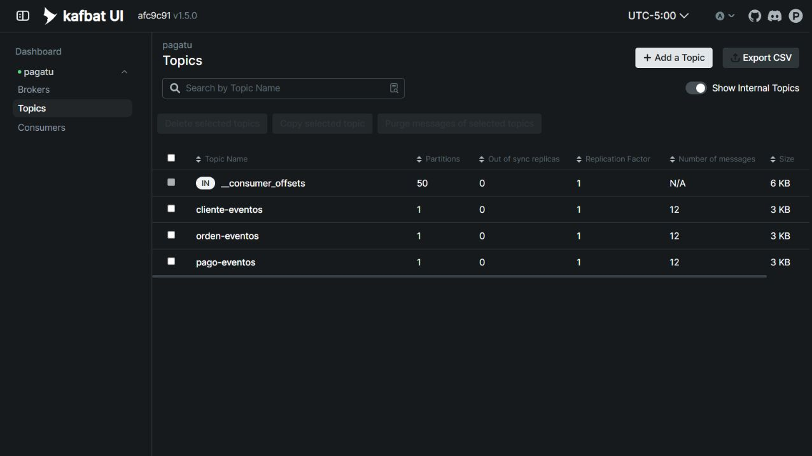

# S08 · Mensajería asíncrona

**Jannys Graciela Navarro Acrota** · Tarea personal de Sistemas Distribuidos.

Grupo de referencia: Casa o Nada. Esta documentación corresponde al avance individual, no al informe grupal oficial.

## Trabajo realizado

Se integraron órdenes, pagos y cliente mediante Kafka. Cada consumidor utiliza su propio grupo.

| Topic | Uso |
| --- | --- |
| orden-eventos | Solicitar el procesamiento del pago |
| pago-eventos | Comunicar pago validado o fallido |
| cliente-eventos | Registrar aviso de orden confirmada o cancelada |

## Evidencia

Las órdenes 1 y 2 se crearon mientras Kafka no estaba disponible. Sus eventos quedaron en outbox y se procesaron cuando se recuperó el broker. Cliente recibió ambos resultados. Esta fue una prueba de recuperación del broker; no se presenta como una prueba separada de consumidor apagado.

## Explicación breve

El evento permite que los servicios trabajen en momentos distintos. Outbox conserva el mensaje junto con la operación de negocio para no perderlo ante una falla del broker.
