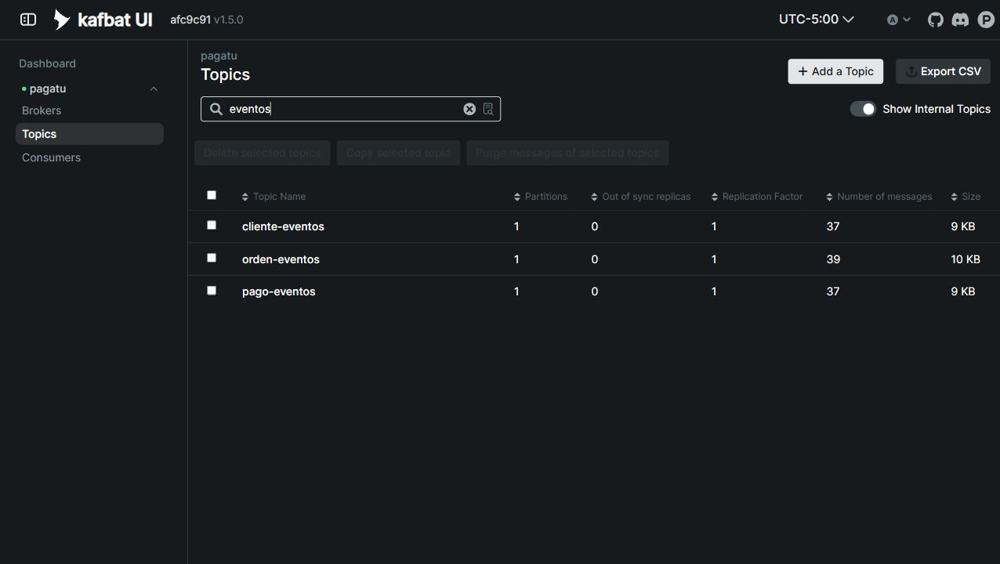
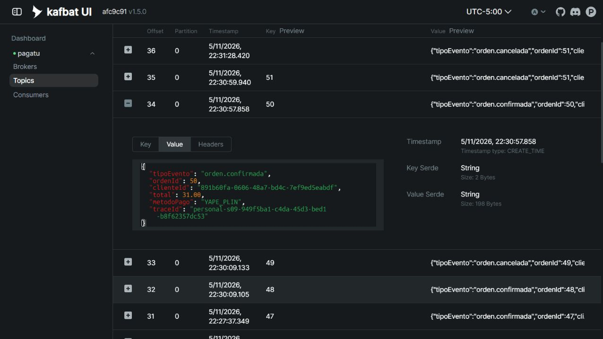
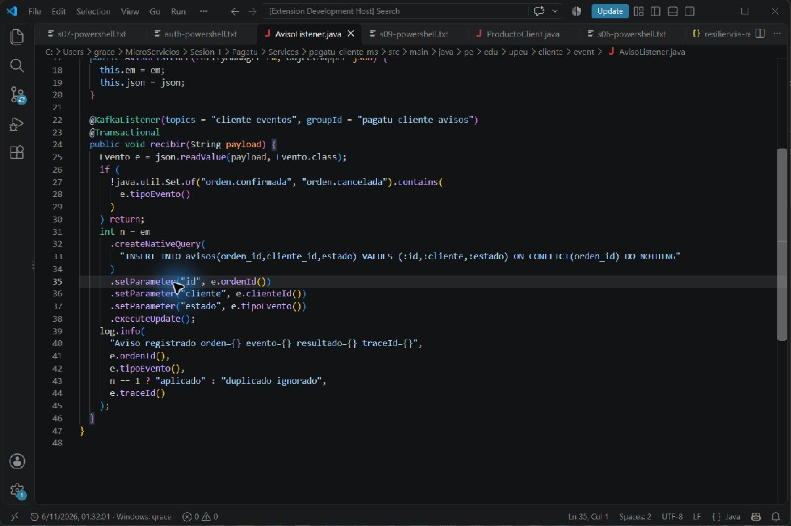
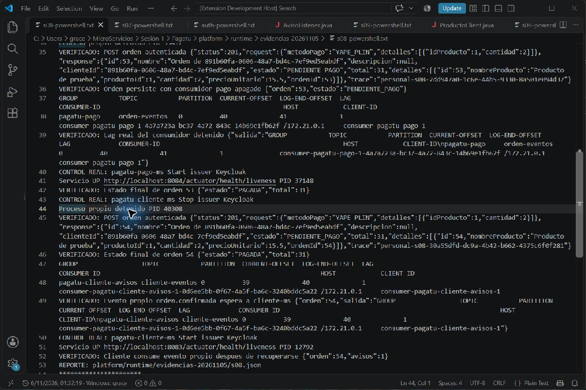

# S08 · Mensajería asíncrona entre servicios

**Estudiante:** Jannys Graciela Navarro Acrota

**Equipo de referencia:** 09 · Casa o Nada

**Entrega:** tarea personal sobre la base Pagatu; implementación individual y verificación local.

**Repositorio:** [https://github.com/Stephmarc/Tareas-Distribuidas](https://github.com/Stephmarc/Tareas-Distribuidas)

**Guía docente:** [Actividad y estructura](https://262dist.github.io/pagatu/sesiones/S08_Mensajeria_Asincrona_Entre_Servicios/#4-crea-actividad-autonoma)

[Descargar informe PDF](S08_Equipo09_NavarroJannys.pdf)

## Qué se ejecutó

Pruebas realizadas el 5 de noviembre de 2026, hora de Lima. Las fechas ISO de los reportes usan UTC y por eso pueden indicar 6 de noviembre. Los IDs, estados y códigos que siguen proceden de las respuestas originales, no de resultados inventados.

Capturas complementarias de VS Code tomadas el 6 de noviembre de 2026, con reloj real y usuario Windows visibles. Muestran código y archivos originales de las pruebas del 5 de noviembre; visualizar un transcript no constituye una nueva ejecución.

## 1. Kafka y pago

El broker personal y pago-ms están ejecutándose. Kafka UI muestra orden-eventos, pago-eventos y cliente-eventos, cada uno con una partición. Pago tiene su propia base y su propio grupo pagatu-pago.

## 2. Publicación y consumo

La orden y su outbox se escriben en la misma transacción local. Un publicador separado lee filas confirmadas y envía el mensaje con key=ordenId. Pago inserta su resultado y otro outbox; órdenes recibe pago.validado y pasa a PAGADA.

## 3. Desacople con consumidor detenido

La prueba detuvo pago, creó la orden 53 y comprobó PENDIENTE_PAGO y lag real 1. Tras recuperar pago llegó a PAGADA. El transcript conserva los offsets, no una etiqueta redactada manualmente.

## 4. Evento adicional propio

Órdenes publica orden.confirmada u orden.cancelada en cliente-eventos. Cliente consume con group-id pagatu-cliente-avisos y registra avisos sin llamada HTTP entre ambos. Se apagó cliente para la orden 54; Kafka conservó los eventos y al recuperarlo hubo exactamente un aviso. La ejecución final registra lag 1; una ejecución anterior registró 2. Se conservan los offsets reales de cada prueba, sin ajustar los resultados al ejemplo.

### Contrato del evento adicional

**Topic:** `cliente-eventos` · **key:** `ordenId.toString()` · **Dueño:** órdenes · **Consumidor:** cliente · **group-id:** `pagatu-cliente-avisos`.

| Campo | Tipo | Significado |
|---|---|---|
| tipoEvento | string | orden.confirmada u orden.cancelada |
| ordenId | long | Agregado y key del mensaje |
| clienteId | string | sub del comprador |
| total | decimal | Importe decidido por órdenes |
| metodoPago | string | Método usado en la simulación |
| traceId | string | Correlación a través del proceso |

## Código incorporado y su función

### `OutboxService.java`

[Ver archivo y líneas en GitHub](https://github.com/Stephmarc/Tareas-Distribuidas/blob/main/Services/pagatu-orden-ms/src/main/java/pe/edu/upeu/orden/event/OutboxService.java#L40)

```java
 40   @Scheduled(fixedDelay = 2000)
 41   @Transactional
 42   public void publicar() {
 43     for (Outbox o : r.findTop20ByEnviadoFalseOrderByIdAsc()) {
 44       try {
 45         kafka.send(o.topic, o.messageKey, o.payload).get(5, TimeUnit.SECONDS);
 46         o.enviado = true;
 47         r.save(o);
 48         log.info(
 49           "Evento publicado topic={} key={} payload={}",
 50           o.topic,
 51           o.messageKey,
 52           o.payload
 53         );
 54       } catch (Exception ex) {
 55         log.warn(
 56           "Outbox pendiente key={} motivo={}",
 57           o.eventKey,
 58           ex.toString()
 59         );
 60         break;
 61       }
 62     }
 63   }
 64 }
```

### `AvisoListener.java`

[Ver archivo y líneas en GitHub](https://github.com/Stephmarc/Tareas-Distribuidas/blob/main/Services/pagatu-cliente-ms/src/main/java/pe/edu/upeu/cliente/event/AvisoListener.java#L27)

```java
 27       !java.util.Set.of("orden.confirmada", "orden.cancelada").contains(
 28         e.tipoEvento()
 29       )
 30     ) return;
 31     int n = em
 32       .createNativeQuery(
 33         "INSERT INTO avisos(orden_id,cliente_id,estado) VALUES (:id,:cliente,:estado) ON CONFLICT(orden_id) DO NOTHING"
 34       )
 35       .setParameter("id", e.ordenId())
 36       .setParameter("cliente", e.clienteId())
 37       .setParameter("estado", e.tipoEvento())
 38       .executeUpdate();
 39     log.info(
 40       "Aviso registrado orden={} evento={} resultado={} traceId={}",
 41       e.ordenId(),
 42       e.tipoEvento(),
 43       n == 1 ? "aplicado" : "duplicado ignorado",
 44       e.traceId()
 45     );
 46   }
 47 }
```

## Comandos ejecutados y resultados originales

Los `.txt` son transcripts originales de PowerShell. Las capturas que los muestran en VS Code son vistas del archivo original, no fotografías de una ventana CMD. Los JSON conservan requests, respuestas, estados y trazas.

```powershell
& ".\scripts\Run-PersonalEvidence.ps1" -Sesion s08
```

- [Salida original: s08.json](assets/s08.json)
- [Salida original: s08-intento-codificacion.json](assets/s08-intento-codificacion.json)
- [Salida original: s08-intento-codificacion-powershell.txt](assets/s08-intento-codificacion-powershell.txt)
- [Salida original: s08-powershell.txt](assets/s08-powershell.txt)

### Intentos conservados y ejecución final

Se conserva un intento previo que falló al validar la ruta acentuada de un PID. La comprobación se detuvo antes de tocar el proceso, se corrigió la lectura UTF-8 y se repitió la prueba completa con resultado APROBADO.

### Respuesta original completa

```json
{
  "sesion": "s08",
  "fecha": "2026-11-06T03:56:57.955Z",
  "usuarioWindows": "grace",
  "estudiante": "Jannys Graciela Navarro Acrota",
  "pasos": [
    {
      "prueba": "POST orden autenticada",
      "status": 201,
      "request": {
        "metodoPago": "YAPE_PLIN",
        "detalles": [
          {
            "idProducto": 1,
            "cantidad": 2
          }
        ]
      },
      "response": {
        "id": 53,
        "nombre": "Orden de 891b60fa-0606-48a7-bd4c-7ef9ed5eabdf",
        "descripcion": null,
        "clienteId": "891b60fa-0606-48a7-bd4c-7ef9ed5eabdf",
        "estado": "PENDIENTE_PAGO",
        "total": 31,
        "detalles": [
          {
            "id": 53,
            "nombreProducto": "Producto de prueba",
            "productoId": 1,
            "cantidad": 2,
            "precioUnitario": 15.5,
            "ordenId": 53
          }
        ]
      },
      "trace": "personal-s08-2dd947a0-1c6e-44b5-9330-8a501e094d37"
    },
    {
      "prueba": "Orden persiste con consumidor pago apagado",
      "orden": 53,
      "estado": "PENDIENTE_PAGO"
    },
    {
      "prueba": "Lag real del consumidor detenido",
      "salida": "GROUP           TOPIC           PARTITION  CURRENT-OFFSET  LOG-END-OFFSET  LAG             CONSUMER-ID                                                 HOST            CLIENT-ID\npagatu-pago     orden-eventos   0          40              41              1               consumer-pagatu-pago-1-4a7a723a-bc37-4a72-843c-14b69e1fb62f /172.21.0.1     consumer-pagatu-pago-1"
    },
    {
      "prueba": "Estado final de orden 53",
      "estado": "PAGADA",
      "total": 31
    },
    {
      "prueba": "POST orden autenticada",
      "status": 201,
      "request": {
        "metodoPago": "YAPE_PLIN",
        "detalles": [
          {
            "idProducto": 1,
            "cantidad": 2
          }
        ]
      },
      "response": {
        "id": 54,
        "nombre": "Orden de 891b60fa-0606-48a7-bd4c-7ef9ed5eabdf",
        "descripcion": null,
        "clienteId": "891b60fa-0606-48a7-bd4c-7ef9ed5eabdf",
        "estado": "PENDIENTE_PAGO",
        "total": 31,
        "detalles": [
          {
            "id": 54,
            "nombreProducto": "Producto de prueba",
            "productoId": 1,
            "cantidad": 2,
            "precioUnitario": 15.5,
            "ordenId": 54
          }
        ]
      },
      "trace": "personal-s08-30a55dfd-dc9a-4b42-b662-4375c6f0f281"
    },
    {
      "prueba": "Estado final de orden 54",
      "estado": "PAGADA",
      "total": 31
    },
    {
      "prueba": "Evento propio orden.confirmada espera a cliente-ms",
      "orden": 54,
      "salida": "GROUP                 TOPIC           PARTITION  CURRENT-OFFSET  LOG-END-OFFSET  LAG             CONSUMER-ID                                                           HOST            CLIENT-ID\npagatu-cliente-avisos cliente-eventos 0          39              40              1               consumer-pagatu-cliente-avisos-1-0d6ee5bb-0f67-4a5f-ba6c-3240bddc5a22 /172.21.0.1     consumer-pagatu-cliente-avisos-1"
    },
    {
      "prueba": "Cliente consume evento propio despues de recuperarse",
      "orden": 54,
      "avisos": 1
    }
  ],
  "lagPago": "GROUP           TOPIC           PARTITION  CURRENT-OFFSET  LOG-END-OFFSET  LAG             CONSUMER-ID                                                 HOST            CLIENT-ID\npagatu-pago     orden-eventos   0          40              41              1               consumer-pagatu-pago-1-4a7a723a-bc37-4a72-843c-14b69e1fb62f /172.21.0.1     consumer-pagatu-pago-1",
  "lagCliente": "GROUP                 TOPIC           PARTITION  CURRENT-OFFSET  LOG-END-OFFSET  LAG             CONSUMER-ID                                                           HOST            CLIENT-ID\npagatu-cliente-avisos cliente-eventos 0          39              40              1               consumer-pagatu-cliente-avisos-1-0d6ee5bb-0f67-4a5f-ba6c-3240bddc5a22 /172.21.0.1     consumer-pagatu-cliente-avisos-1",
  "ordenes": {
    "pago": 53,
    "eventoPropio": 54
  },
  "resultado": "APROBADO"
}
```

## Capturas reales

Las imágenes se conservan completas, sin superponer resultados ni modificar fechas. El reloj de VS Code es una extensión local que lee la hora del equipo; el modo `?evidencia=1` de Angular muestra la hora real y el usuario autenticado. Las vistas web de Kafka/Grafana son complementarias y no incluyen por sí solas el reloj de Windows.



*S08 topics. Captura íntegra de la vista real; consultar la salida original para los detalles completos.*



*Kafka UI: orden.confirmada de la orden 50 con key 50 y contrato completo. Corresponde a la ejecución anterior conservada en S09/assets/s09-primera-aprobada.json.. Captura íntegra de la vista real; consultar la salida original para los detalles completos.*



*Código real: topic cliente-eventos, grupo pagatu-cliente-avisos, eventos orden.confirmada/orden.cancelada y registro idempotente de avisos.. Captura íntegra de la vista real; consultar la salida original para los detalles completos.*



*Transcript original: pago detenido, orden 53 pendiente y lag 1, luego PAGADA. Cliente detenido, orden 54 y lag 1, con un aviso después de recuperarse.. Captura íntegra de la vista real; consultar la salida original para los detalles completos.*

## Error o hallazgo real

El lag depende de cuántos hechos quedaron pendientes. En la prueba de cliente fueron 2, aunque el ejemplo docente muestre 1; ambos se consumieron al recuperar el servicio. La evidencia conserva el número real. También se conservó un intento que detuvo la verificación antes de actuar porque PowerShell devolvía la ruta acentuada con otra codificación. Se corrigió la lectura CIM a UTF-8 y se repitió la prueba completa; los procesos se validan antes de detenerse.

## Reflexión técnica

Orden creada lleva ordenId, clienteId, total y método de pago.
Ese contrato permite que pago decida sin consultar la base de órdenes.
El traceId permite seguir el proceso por varios consumidores.
Si solo viajara el identificador, pago necesitaría otra llamada para completar los datos.
Esa dependencia reduciría el desacople justo cuando órdenes estuviera caído.
Kafka conserva el mensaje mientras el consumidor está detenido.
El outbox puede reenviar después de un fallo; por eso el consumidor debe ser idempotente.

## Anexo · Feedback de la sesión

**Lo completa la estudiante.** Estas respuestas describen tu experiencia en clase; no se inventan ni se califica tu esfuerzo automáticamente. En el PDF hay campos editables.

1. ¿Cuál es el aprendizaje más importante que te llevas de la clase de hoy?

   Respuesta: ______________________________

2. ¿Qué punto de la clase te resultó más confuso o te dejó con dudas?

   Respuesta: ______________________________

3. ¿Tienes alguna pregunta para la siguiente clase?

   Respuesta: ______________________________

4. Nivel de comprensión: Entendido / Más o menos / Necesito ayuda.

   Respuesta: ______________________________

5. ¿Cómo puede ayudarte el docente a comprender mejor el tema?

   Respuesta: ______________________________

6. Participación: Muy comprometido/a / Comprometido/a / Poco comprometido/a.

   Respuesta: ______________________________

7. Satisfacción con la clase: 1 a 10.

   Respuesta: ______________________________

## Alcance y límites

Este informe documenta la tarea personal sobre Pagatu. La guía del docente también exige adaptar actividades al Proyecto Sello del equipo: la entrega grupal CASAS es independiente y no se presenta aquí como si fuera esta implementación. No se atribuye una defensa oral ni un resultado de evaluación que no se haya realizado.
