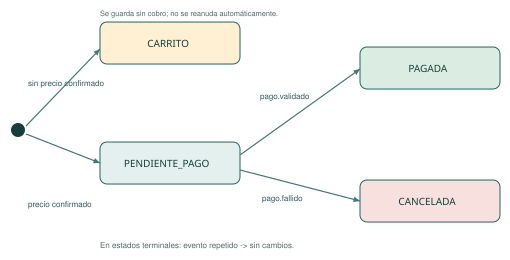
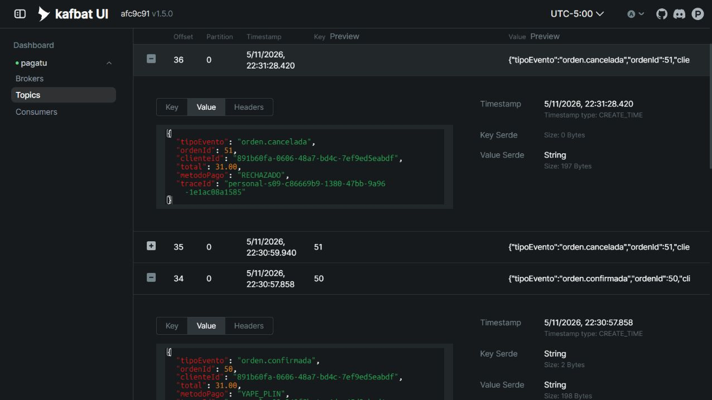
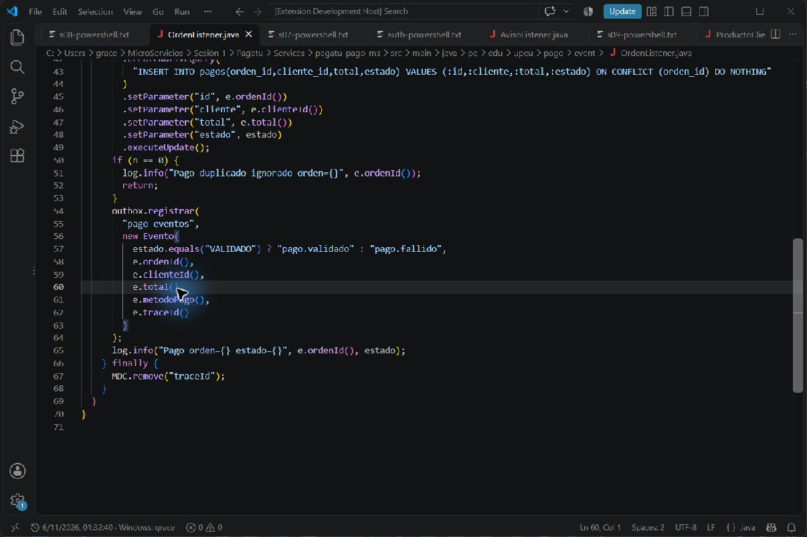
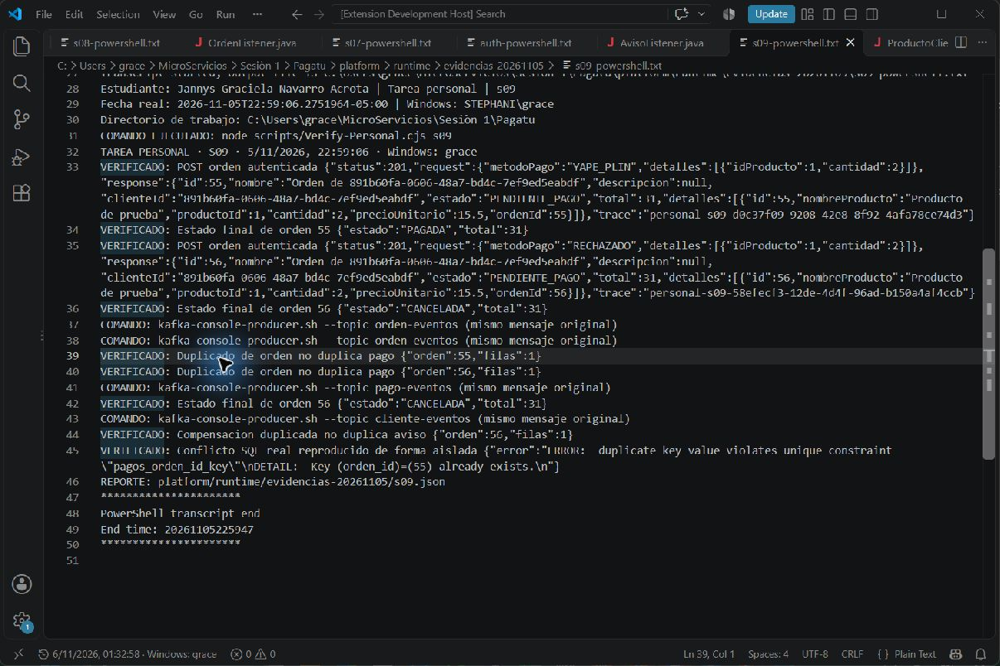

# S09 · Consistencia distribuida en procesos de negocio

**Estudiante:** Jannys Graciela Navarro Acrota

**Equipo de referencia:** 09 · Casa o Nada

**Entrega:** tarea personal sobre la base Pagatu; implementación individual y verificación local.

**Repositorio:** [https://github.com/Stephmarc/Tareas-Distribuidas](https://github.com/Stephmarc/Tareas-Distribuidas)

**Guía docente:** [Actividad y estructura](https://262dist.github.io/pagatu/sesiones/S09_Consistencia_Distribuida_Procesos_Negocio/#4-crea-actividad-autonoma)

[Descargar informe PDF](S09_Equipo09_NavarroJannys.pdf)

## Qué se ejecutó

Pruebas realizadas el 5 de noviembre de 2026, hora de Lima. Las fechas ISO de los reportes usan UTC y por eso pueden indicar 6 de noviembre. Los IDs, estados y códigos que siguen proceden de las respuestas originales, no de resultados inventados.

Capturas complementarias de VS Code tomadas el 6 de noviembre de 2026, con reloj real y usuario Windows visibles. Muestran código y archivos originales de las pruebas del 5 de noviembre; visualizar un transcript no constituye una nueva ejecución.

## 1. Conflicto real y protección idempotente

Se reprodujo de forma aislada una violación SQL de pagos_orden_id_key mediante INSERT SELECT de un pago de prueba. Después se reenviaron los mensajes originales con kafka-console-producer: quedó una sola fila por orden y los logs indicaron duplicado ignorado. Esta reproducción no se presenta como una ejecución histórica de una versión insegura.

## 2. Fallo y compensación

La orden 55 terminó PAGADA. La orden 56, con método de prueba RECHAZADO, produjo pago.fallido y terminó CANCELADA. Es un rechazo funcional determinista del simulador local, sin cobros bancarios reales.

## 3. Compensación idempotente

Se reenvió el mismo pago.fallido. El UPDATE de órdenes exige estado PENDIENTE_PAGO: el segundo evento no vuelve a modificar una orden terminal ni genera un segundo aviso. Se confirmó CANCELADA después del duplicado.

## 4. Proceso adicional y estados

El proceso de avisos también usa UNIQUE(orden_id) y ON CONFLICT DO NOTHING. Se reenvió orden.cancelada y permaneció una sola fila. El diagrama incluye CARRITO, PENDIENTE_PAGO, PAGADA y CANCELADA. Este proceso no reserva stock, cupos ni saldo; no se presenta el bono opcional de stock.

### Diagrama completo de estados

```text
Inicio -> CARRITO [catálogo no confirmó precio]
Inicio -> PENDIENTE_PAGO [precio confirmado, orden.creada]
PENDIENTE_PAGO -> PAGADA [pago.validado]
PENDIENTE_PAGO -> CANCELADA [pago.fallido]
PAGADA/CANCELADA + evento repetido -> sin cambio
CARRITO: conservado sin cobro; no existe reanudación automática.
```



*Diagrama elaborado a partir de las guardias reales del código; no es una captura de ejecución.*

## Código incorporado y su función

### `OrdenListener.java`

[Ver archivo y líneas en GitHub](https://github.com/Stephmarc/Tareas-Distribuidas/blob/main/Services/pagatu-pago-ms/src/main/java/pe/edu/upeu/pago/event/OrdenListener.java#L44)

```java
 44         )
 45         .setParameter("id", e.ordenId())
 46         .setParameter("cliente", e.clienteId())
 47         .setParameter("total", e.total())
 48         .setParameter("estado", estado)
 49         .executeUpdate();
 50       if (n == 0) {
 51         log.info("Pago duplicado ignorado orden={}", e.ordenId());
 52         return;
 53       }
 54       outbox.registrar(
 55         "pago-eventos",
 56         new Evento(
 57           estado.equals("VALIDADO") ? "pago.validado" : "pago.fallido",
 58           e.ordenId(),
 59           e.clienteId(),
 60           e.total(),
 61           e.metodoPago(),
 62           e.traceId()
 63         )
 64       );
 65       log.info("Pago orden={} estado={}", e.ordenId(), estado);
 66     } finally {
 67       MDC.remove("traceId");
 68     }
 69   }
 70 }
```

### `PagoListener.java`

[Ver archivo y líneas en GitHub](https://github.com/Stephmarc/Tareas-Distribuidas/blob/main/Services/pagatu-orden-ms/src/main/java/pe/edu/upeu/orden/event/PagoListener.java#L35)

```java
 35       default -> null;
 36     };
 37     if (estado == null) return;
 38     try {
 39       if (e.traceId() != null) MDC.put("traceId", e.traceId());
 40       int n = em
 41         .createQuery(
 42           "update Orden o set o.estado=:estado where o.id=:id and o.estado='PENDIENTE_PAGO'"
 43         )
 44         .setParameter("estado", estado)
 45         .setParameter("id", e.ordenId())
 46         .executeUpdate();
 47       log.info(
 48         "Saga orden={} estado={} resultado={}",
 49         e.ordenId(),
 50         estado,
 51         n == 1 ? "aplicado" : "duplicado ignorado"
 52       );
 53       if (n == 1) outbox.registrar(
 54         "cliente-eventos",
 55         new Evento(
 56           estado.equals("PAGADA") ? "orden.confirmada" : "orden.cancelada",
 57           e.ordenId(),
 58           e.clienteId(),
 59           e.total(),
 60           e.metodoPago(),
 61           e.traceId()
 62         )
```

### `V1__pagos.sql`

[Ver archivo y líneas en GitHub](https://github.com/Stephmarc/Tareas-Distribuidas/blob/main/Services/pagatu-pago-ms/src/main/resources/db/migration/V1__pagos.sql#L1)

```sql
  1 CREATE TABLE pagos(id BIGINT GENERATED BY DEFAULT AS IDENTITY PRIMARY KEY,orden_id BIGINT NOT NULL UNIQUE,cliente_id VARCHAR(100) NOT NULL,total NUMERIC(10,2) NOT NULL,estado VARCHAR(30) NOT NULL);
```

## Comandos ejecutados y resultados originales

Los `.txt` son transcripts originales de PowerShell. Las capturas que los muestran en VS Code son vistas del archivo original, no fotografías de una ventana CMD. Los JSON conservan requests, respuestas, estados y trazas.

```powershell
& ".\scripts\Run-PersonalEvidence.ps1" -Sesion s09
```

- [Salida original: s09.json](assets/s09.json)
- [Salida original: s09-primera-aprobada.json](assets/s09-primera-aprobada.json)
- [Salida original: s09-intento-emisor-propio.json](assets/s09-intento-emisor-propio.json)
- [Salida original: s09-intento-emisor-propio-powershell.txt](assets/s09-intento-emisor-propio-powershell.txt)
- [Salida original: s09-powershell.txt](assets/s09-powershell.txt)

### Intentos conservados y ejecución final

Se conserva un intento que recibió 401 mientras S07 usaba temporalmente el emisor propio. Después de restaurar Keycloak se repitió S09 con resultado APROBADO. La captura de Kafka de la orden 51 corresponde al reporte anterior aprobado, también adjunto; la prueba final usa las órdenes 55 y 56.

### Respuesta original completa

```json
{
  "sesion": "s09",
  "fecha": "2026-11-06T03:59:06.454Z",
  "usuarioWindows": "grace",
  "estudiante": "Jannys Graciela Navarro Acrota",
  "pasos": [
    {
      "prueba": "POST orden autenticada",
      "status": 201,
      "request": {
        "metodoPago": "YAPE_PLIN",
        "detalles": [
          {
            "idProducto": 1,
            "cantidad": 2
          }
        ]
      },
      "response": {
        "id": 55,
        "nombre": "Orden de 891b60fa-0606-48a7-bd4c-7ef9ed5eabdf",
        "descripcion": null,
        "clienteId": "891b60fa-0606-48a7-bd4c-7ef9ed5eabdf",
        "estado": "PENDIENTE_PAGO",
        "total": 31,
        "detalles": [
          {
            "id": 55,
            "nombreProducto": "Producto de prueba",
            "productoId": 1,
            "cantidad": 2,
            "precioUnitario": 15.5,
            "ordenId": 55
          }
        ]
      },
      "trace": "personal-s09-d0c37f09-9208-42e8-8f92-4afa78ce74d3"
    },
    {
      "prueba": "Estado final de orden 55",
      "estado": "PAGADA",
      "total": 31
    },
    {
      "prueba": "POST orden autenticada",
      "status": 201,
      "request": {
        "metodoPago": "RECHAZADO",
        "detalles": [
          {
            "idProducto": 1,
            "cantidad": 2
          }
        ]
      },
      "response": {
        "id": 56,
        "nombre": "Orden de 891b60fa-0606-48a7-bd4c-7ef9ed5eabdf",
        "descripcion": null,
        "clienteId": "891b60fa-0606-48a7-bd4c-7ef9ed5eabdf",
        "estado": "PENDIENTE_PAGO",
        "total": 31,
        "detalles": [
          {
            "id": 56,
            "nombreProducto": "Producto de prueba",
            "productoId": 1,
            "cantidad": 2,
            "precioUnitario": 15.5,
            "ordenId": 56
          }
        ]
      },
      "trace": "personal-s09-58efecf3-12de-4d4f-96ad-b150a4af4ccb"
    },
    {
      "prueba": "Estado final de orden 56",
      "estado": "CANCELADA",
      "total": 31
    },
    {
      "prueba": "Duplicado de orden no duplica pago",
      "orden": 55,
      "filas": 1
    },
    {
      "prueba": "Duplicado de orden no duplica pago",
      "orden": 56,
      "filas": 1
    },
    {
      "prueba": "Estado final de orden 56",
      "estado": "CANCELADA",
      "total": 31
    },
    {
      "prueba": "Compensacion duplicada no duplica aviso",
      "orden": 56,
      "filas": 1
    },
    {
      "prueba": "Conflicto SQL real reproducido de forma aislada",
      "error": "ERROR:  duplicate key value violates unique constraint \"pagos_orden_id_key\"\nDETAIL:  Key (orden_id)=(55) already exists.\n"
    }
  ],
  "logs": {
    "orden": [
      "2026-11-05 22:59:08.003 [personal-s09-d0c37f09-9208-42e8-8f92-4afa78ce74d3] INFO  p.edu.upeu.orden.event.PagoListener - Saga orden=55 estado=PAGADA resultado=aplicado",
      "2026-11-05 22:59:12.060 [personal-s09-58efecf3-12de-4d4f-96ad-b150a4af4ccb] INFO  p.edu.upeu.orden.event.PagoListener - Saga orden=56 estado=CANCELADA resultado=aplicado",
      "2026-11-05 22:59:33.679 [personal-s09-58efecf3-12de-4d4f-96ad-b150a4af4ccb] INFO  p.edu.upeu.orden.event.PagoListener - Saga orden=56 estado=CANCELADA resultado=duplicado ignorado"
    ],
    "pago": [
      "2026-11-05T22:59:06.995-05:00  INFO [traceId=personal-s09-d0c37f09-9208-42e8-8f92-4afa78ce74d3] 37148 --- [pagatu-pago-ms] [org.springframework.kafka.KafkaListenerEndpointContainer#0-0-C-1] pe.edu.upeu.pago.event.OrdenListener     : Pago orden=55 estado=VALIDADO",
      "2026-11-05T22:59:11.127-05:00  INFO [traceId=personal-s09-58efecf3-12de-4d4f-96ad-b150a4af4ccb] 37148 --- [pagatu-pago-ms] [org.springframework.kafka.KafkaListenerEndpointContainer#0-0-C-1] pe.edu.upeu.pago.event.OrdenListener     : Pago orden=56 estado=RECHAZADO",
      "2026-11-05T22:59:17.508-05:00  INFO [traceId=personal-s09-d0c37f09-9208-42e8-8f92-4afa78ce74d3] 37148 --- [pagatu-pago-ms] [org.springframework.kafka.KafkaListenerEndpointContainer#0-0-C-1] pe.edu.upeu.pago.event.OrdenListener     : Pago duplicado ignorado orden=55",
      "2026-11-05T22:59:23.376-05:00  INFO [traceId=personal-s09-58efecf3-12de-4d4f-96ad-b150a4af4ccb] 37148 --- [pagatu-pago-ms] [org.springframework.kafka.KafkaListenerEndpointContainer#0-0-C-1] pe.edu.upeu.pago.event.OrdenListener     : Pago duplicado ignorado orden=56"
    ],
    "cliente": [
      "2026-11-05T22:59:09.037-05:00  INFO [traceId=] 12792 --- [pagatu-cliente-ms] [org.springframework.kafka.KafkaListenerEndpointContainer#0-0-C-1] p.edu.upeu.cliente.event.AvisoListener   : Aviso registrado orden=55 evento=orden.confirmada resultado=aplicado traceId=personal-s09-d0c37f09-9208-42e8-8f92-4afa78ce74d3",
      "2026-11-05T22:59:13.183-05:00  INFO [traceId=] 12792 --- [pagatu-cliente-ms] [org.springframework.kafka.KafkaListenerEndpointContainer#0-0-C-1] p.edu.upeu.cliente.event.AvisoListener   : Aviso registrado orden=56 evento=orden.cancelada resultado=aplicado traceId=personal-s09-58efecf3-12de-4d4f-96ad-b150a4af4ccb",
      "2026-11-05T22:59:42.636-05:00  INFO [traceId=] 12792 --- [pagatu-cliente-ms] [org.springframework.kafka.KafkaListenerEndpointContainer#0-0-C-1] p.edu.upeu.cliente.event.AvisoListener   : Aviso registrado orden=56 evento=orden.cancelada resultado=duplicado ignorado traceId=personal-s09-58efecf3-12de-4d4f-96ad-b150a4af4ccb"
    ]
  },
  "ordenes": {
    "pagada": 55,
    "cancelada": 56
  },
  "trace": "personal-s09-d0c37f09-9208-42e8-8f92-4afa78ce74d3",
  "resultado": "APROBADO"
}
```

## Capturas reales

Las imágenes se conservan completas, sin superponer resultados ni modificar fechas. El reloj de VS Code es una extensión local que lee la hora del equipo; el modo `?evidencia=1` de Angular muestra la hora real y el usuario autenticado. Las vistas web de Kafka/Grafana son complementarias y no incluyen por sí solas el reloj de Windows.



*Kafka UI: orden.cancelada de la orden 51 repetida en offsets 35 y 36; la ejecución correspondiente se conserva en s09-primera-aprobada.json. La validación final puede usar otros IDs.. Captura íntegra de la vista real; consultar la salida original para los detalles completos.*



*Código real: ON CONFLICT DO NOTHING, revisión de filas afectadas y publicación de pago.validado o pago.fallido.. Captura íntegra de la vista real; consultar la salida original para los detalles completos.*



*Transcript original: 55 PAGADA y 56 CANCELADA, eventos repetidos sin duplicar pagos/avisos y conflicto UNIQUE real reproducido de forma aislada.. Captura íntegra de la vista real; consultar la salida original para los detalles completos.*

## Error o hallazgo real

El INSERT repetido provoca una excepción UNIQUE real. El consumidor usa una operación atómica ON CONFLICT y revisa el número de filas afectadas; una comprobación solo en memoria no cubriría reinicios ni carreras.

## Reflexión técnica

La confirmación de un efecto y la del mensaje pueden fallar en momentos distintos.
El productor puede no saber si el consumidor terminó y volver a enviar.
Aceptar al menos una vez exige que repetir el evento no repita el efecto.
La restricción UNIQUE hace persistente esa garantía en el pago.
La guardia de estado protege la compensación y evita duplicar el aviso.
El caso Knight Capital ilustra el daño que puede causar repetir acciones no controladas.
La garantía útil se verifica en el efecto de negocio, no contando entregas del broker.

## Anexo · Feedback de la sesión

**Lo completa la estudiante.** Estas respuestas describen tu experiencia en clase; no se inventan ni se califica tu esfuerzo automáticamente. En el PDF hay campos editables.

1. ¿Cuál es el aprendizaje más importante que te llevas de la clase de hoy?

   Respuesta: ______________________________

2. ¿Qué punto de la clase te resultó más confuso o te dejó con dudas?

   Respuesta: ______________________________

3. ¿Tienes alguna pregunta para la siguiente clase?

   Respuesta: ______________________________

4. Nivel de comprensión: Entendido / Más o menos / Necesito ayuda.

   Respuesta: ______________________________

5. ¿Cómo puede ayudarte el docente a comprender mejor el tema?

   Respuesta: ______________________________

6. Participación: Muy comprometido/a / Comprometido/a / Poco comprometido/a.

   Respuesta: ______________________________

7. Satisfacción con la clase: 1 a 10.

   Respuesta: ______________________________

## Alcance y límites

Este informe documenta la tarea personal sobre Pagatu. La guía del docente también exige adaptar actividades al Proyecto Sello del equipo: la entrega grupal CASAS es independiente y no se presenta aquí como si fuera esta implementación. No se atribuye una defensa oral ni un resultado de evaluación que no se haya realizado.
