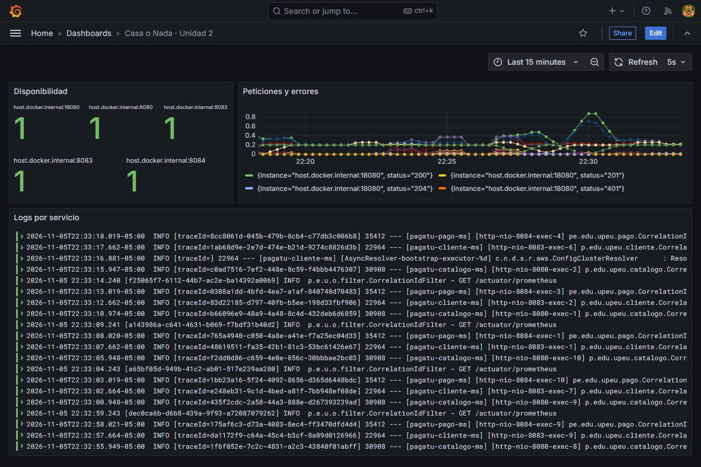

# S10 · Observabilidad y diagnóstico

**Estudiante:** Jannys Graciela Navarro Acrota

**Equipo de referencia:** 09 · Casa o Nada

**Entrega:** tarea personal sobre la base Pagatu; implementación individual y verificación local.

**Repositorio:** [https://github.com/Stephmarc/Tareas-Distribuidas](https://github.com/Stephmarc/Tareas-Distribuidas)

**Guía docente:** [Actividad y estructura](https://262dist.github.io/pagatu/sesiones/S10_Observabilidad_Diagnostico_Sistemas_Distribuidos/#4-crea-actividad-autonoma)

[Descargar informe PDF](S10_Equipo09_NavarroJannys.pdf)

## Qué se ejecutó

Pruebas realizadas el 5 de noviembre de 2026, hora de Lima. Las fechas ISO de los reportes usan UTC y por eso pueden indicar 6 de noviembre. Los IDs, estados y códigos que siguen proceden de las respuestas originales, no de resultados inventados.

## 1. Health groups reales

Cliente configura livenessState en liveness y readinessState,db en readiness. Antes de la falla ambos devuelven 200 UP. Se detuvo el contenedor PostgreSQL de cliente, manteniendo vivo su proceso Java.

## 2. Logs y correlación

El mismo X-Trace-ID de una orden aparece en Loki en catálogo, órdenes, pago y cliente. El filtro lo almacena en MDC; Feign lo propaga por HTTP y los eventos lo llevan como traceId. El JSON original incluye las cuatro etiquetas de servicio y sus líneas.

## 3. Tablero propio

Grafana usa Prometheus y Loki provisionados desde obs. Incluye disponibilidad, tasa de peticiones/errores y logs por servicio. La captura es del tablero con series y logs reales, no de la pantalla vacía de bienvenida.

## 4. Diagnóstico de falla

Con PostgreSQL detenido, liveness respondió 200 UP, readiness 503 DOWN y GET clientes 500. Loki registró Connection refused hacia localhost:15434 y agotamiento de conexiones Hikari. Al recuperar el mismo contenedor, readiness volvió a 200 UP sin borrar datos.

### Tabla de diagnóstico real

| Momento | Liveness | Readiness | Negocio | Diagnóstico |
|---|---|---|---|---|
| Antes | 200 UP | 200 UP | Disponible | PostgreSQL operativo |
| PostgreSQL detenido | 200 UP | 503 DOWN | GET clientes 500 | Connection refused:15434 / Hikari |
| Recuperado | 200 UP | 200 UP | Se restablece dependencia | Mismo contenedor, sin borrar datos |

## Código incorporado y su función

### `pagatu-cliente-ms-dev.yml`

[Ver archivo y líneas en GitHub](https://github.com/Stephmarc/Tareas-Distribuidas/blob/main/Infra/pagatu-config/config-repo/pagatu-cliente-ms-dev.yml#L1)

```yaml
  1 server:
  2   port: 8083
  3 spring:
  4   datasource:
  5     url: ${DB_URL:jdbc:postgresql://localhost:15434/pagatu_cliente_db}
  6     username: ${DB_USER:pagatu}
  7     password: ${DB_PASSWORD:pagatu}
  8   jpa:
  9     hibernate:
 10       ddl-auto: validate
```

### `pagatu-cliente-ms-dev.yml`

[Ver archivo y líneas en GitHub](https://github.com/Stephmarc/Tareas-Distribuidas/blob/main/Infra/pagatu-config/config-repo/pagatu-cliente-ms-dev.yml#L25)

```yaml
 25     web:
 26       exposure:
 27         include: health,info,prometheus,metrics
 28   endpoint:
 29     health:
 30       probes:
 31         enabled: true
 32       group:
 33         liveness:
 34           include: livenessState
 35         readiness:
 36           include: readinessState,db
 37 logging:
 38   file:
 39     name: logs/cliente.log
 40   pattern:
 41     level: "%5p [traceId=%X{traceId}]"
 42
 43 spring.kafka.bootstrap-servers: ${KAFKA_BOOTSTRAP:localhost:19092}
 44 spring.kafka.consumer.group-id: pagatu-cliente
 45 spring.kafka.consumer.auto-offset-reset: earliest
 46 spring.kafka.consumer.key-deserializer: org.apache.kafka.common.serialization.StringDeserializer
 47 spring.kafka.consumer.value-deserializer: org.apache.kafka.common.serialization.StringDeserializer
```

### `CorrelationIdFilter.java`

[Ver archivo y líneas en GitHub](https://github.com/Stephmarc/Tareas-Distribuidas/blob/main/Services/pagatu-cliente-ms/src/main/java/pe/edu/upeu/cliente/CorrelationIdFilter.java#L16)

```java
 16     HttpServletResponse r,
 17     FilterChain c
 18   ) throws ServletException, IOException {
 19     String id = q.getHeader("X-Trace-ID");
 20     if (id == null || !id.matches("[A-Za-z0-9._-]{1,100}")) id =
 21       UUID.randomUUID().toString();
 22     MDC.put("traceId", id);
 23     r.setHeader("X-Trace-ID", id);
 24     try {
 25       LoggerFactory.getLogger(getClass()).info(
 26         "{} {}",
 27         q.getMethod(),
 28         q.getRequestURI()
 29       );
 30       c.doFilter(q, r);
 31     } finally {
 32       MDC.remove("traceId");
 33     }
 34   }
 35 }
```

## Comandos ejecutados y resultados originales

Los `.txt` son transcripts originales de PowerShell. Las capturas que los muestran en VS Code son vistas del archivo original, no fotografías de una ventana CMD. Los JSON conservan requests, respuestas, estados y trazas.

```powershell
& ".\scripts\Run-PersonalEvidence.ps1" -Sesion s10
```

- [Salida original: s10.json](assets/s10.json)
- [Salida original: s10-powershell.txt](assets/s10-powershell.txt)

### Respuesta original completa

```json
{
  "sesion": "s10",
  "fecha": "2026-11-06T03:31:32.879Z",
  "usuarioWindows": "grace",
  "estudiante": "Jannys Graciela Navarro Acrota",
  "pasos": [
    {
      "prueba": "Cliente liveness antes de falla",
      "status": 200,
      "response": {
        "status": "UP"
      }
    },
    {
      "prueba": "Cliente readiness antes de falla",
      "status": 200,
      "response": {
        "status": "UP"
      }
    },
    {
      "prueba": "Proceso vivo con PostgreSQL detenido",
      "status": 200,
      "response": {
        "status": "UP"
      }
    },
    {
      "prueba": "Readiness detecta dependencia PostgreSQL real caida",
      "status": 503,
      "response": {
        "status": "DOWN"
      }
    },
    {
      "prueba": "Peticion dependiente de BD falla de forma observable",
      "status": 500,
      "response": {
        "timestamp": "2026-11-06T03:32:35.043Z",
        "status": 500,
        "error": "Internal Server Error",
        "path": "/api/v1/clientes"
      }
    },
    {
      "prueba": "Readiness vuelve a UP tras recuperar PostgreSQL",
      "status": 200,
      "response": {
        "status": "UP"
      }
    },
    {
      "prueba": "Prometheus recoge objetivos reales",
      "data": [
        {
          "metric": {
            "__name__": "up",
            "instance": "host.docker.internal:8083",
            "job": "pagatu"
          },
          "value": [
            1793935960.693,
            "1"
          ]
        },
        {
          "metric": {
            "__name__": "up",
            "instance": "host.docker.internal:8084",
            "job": "pagatu"
          },
          "value": [
            1793935960.693,
            "1"
          ]
        },
        {
          "metric": {
            "__name__": "up",
            "instance": "host.docker.internal:19000",
            "job": "keycloak"
          },
          "value": [
            1793935960.693,
            "1"
          ]
        },
        {
          "metric": {
            "__name__": "up",
            "instance": "host.docker.internal:8082",
            "job": "pagatu"
          },
          "value": [
            1793935960.693,
            "1"
          ]
        },
        {
          "metric": {
            "__name__": "up",
            "instance": "host.docker.internal:18080",
            "job": "pagatu"
          },
          "value": [
            1793935960.693,
            "1"
          ]
        },
        {
          "metric": {
            "__name__": "up",
            "instance": "host.docker.internal:8080",
            "job": "pagatu"
          },
          "value": [
            1793935960.693,
            "1"
          ]
        }
      ]
    },
    {
      "prueba": "Consulta real a Loki con trace de orden",
      "status": 200,
      "streams": [
        {
          "application": "pagatu-catalogo-ms",
          "detected_level": "info",
          "filename": "/logs/catalogo/catalogo.log",
          "service_name": "pagatu-catalogo-ms"
        },
        {
          "application": "pagatu-cliente-ms",
          "detected_level": "info",
          "filename": "/logs/cliente/cliente.log",
          "service_name": "pagatu-cliente-ms"
        },
        {
          "application": "pagatu-orden-ms",
          "detected_level": "info",
          "filename": "/logs/orden/orden.log",
          "service_name": "pagatu-orden-ms"
        },
        {
          "application": "pagatu-pago-ms",
          "detected_level": "info",
          "filename": "/logs/pago/pago.log",
          "service_name": "pagatu-pago-ms"
        }
      ]
    }
  ],
  "loki": {
    "query": "{application=~\"pagatu-.*\"} |= \"personal-s09-949f5ba1-c4da-45d3-bed1-b8f62357dc53\"",
    "response": {
      "status": "success",
      "data": {
        "resultType": "streams",
        "result": [
          {
            "stream": {
              "application": "pagatu-catalogo-ms",
              "detected_level": "info",
              "filename": "/logs/catalogo/catalogo.log",
              "service_name": "pagatu-catalogo-ms"
            },
            "values": [
              [
                "1793935855562849931",
                "2026-11-05T22:30:55.352-05:00  INFO [traceId=personal-s09-949f5ba1-c4da-45d3-bed1-b8f62357dc53] 30908 --- [pagatu-catalogo-ms] [http-nio-8080-exec-1] p.edu.upeu.catalogo.CorrelationIdFilter  : GET /api/v1/productos/1\r"
              ]
            ]
          },
          {
            "stream": {
              "application": "pagatu-cliente-ms",
              "detected_level": "info",
              "filename": "/logs/cliente/cliente.log",
              "service_name": "pagatu-cliente-ms"
            },
            "values": [
              [
                "1793935858010901953",
                "2026-11-05T22:30:57.880-05:00  INFO [traceId=] 22964 --- [pagatu-cliente-ms] [org.springframework.kafka.KafkaListenerEndpointContainer#0-0-C-1] p.edu.upeu.cliente.event.AvisoListener   : Aviso registrado orden=50 evento=orden.confirmada resultado=aplicado traceId=personal-s09-949f5ba1-c4da-45d3-bed1-b8f62357dc53\r"
              ]
            ]
          },
          {
            "stream": {
              "application": "pagatu-orden-ms",
              "detected_level": "info",
              "filename": "/logs/orden/orden.log",
              "service_name": "pagatu-orden-ms"
            },
            "values": [
              [
                "1793935858010884889",
                "2026-11-05 22:30:57.872 [] INFO  p.edu.upeu.orden.event.OutboxService - Evento publicado topic=cliente-eventos key=50 payload={\"tipoEvento\":\"orden.confirmada\",\"ordenId\":50,\"clienteId\":\"891b60fa-0606-48a7-bd4c-7ef9ed5eabdf\",\"total\":31.00,\"metodoPago\":\"YAPE_PLIN\",\"traceId\":\"personal-s09-949f5ba1-c4da-45d3-bed1-b8f62357dc53\"}\r"
              ],
              [
                "1793935856251921559",
                "2026-11-05 22:30:56.037 [personal-s09-949f5ba1-c4da-45d3-bed1-b8f62357dc53] INFO  p.edu.upeu.orden.event.PagoListener - Saga orden=50 estado=PAGADA resultado=aplicado\r"
              ],
              [
                "1793935855999440314",
                "2026-11-05 22:30:55.778 [] INFO  p.edu.upeu.orden.event.OutboxService - Evento publicado topic=orden-eventos key=50 payload={\"tipoEvento\":\"orden.creada\",\"ordenId\":50,\"clienteId\":\"891b60fa-0606-48a7-bd4c-7ef9ed5eabdf\",\"total\":31.00,\"metodoPago\":\"YAPE_PLIN\",\"traceId\":\"personal-s09-949f5ba1-c4da-45d3-bed1-b8f62357dc53\"}\r"
              ],
              [
                "1793935855495549451",
                "2026-11-05 22:30:55.335 [personal-s09-949f5ba1-c4da-45d3-bed1-b8f62357dc53] INFO  p.e.u.o.filter.CorrelationIdFilter - POST /api/v1/ordenes\r"
              ]
            ]
          },
          {
            "stream": {
              "application": "pagatu-pago-ms",
              "detected_level": "info",
              "filename": "/logs/pago/pago.log",
              "service_name": "pagatu-pago-ms"
            },
            "values": [
              [
                "1793935864059340814",
                "2026-11-05T22:31:03.985-05:00  INFO [traceId=personal-s09-949f5ba1-c4da-45d3-bed1-b8f62357dc53] 35412 --- [pagatu-pago-ms] [org.springframework.kafka.KafkaListenerEndpointContainer#0-0-C-1] pe.edu.upeu.pago.event.OrdenListener     : Pago duplicado ignorado orden=50\r"
              ],
              [
                "1793935856251950041",
                "2026-11-05T22:30:56.026-05:00  INFO [traceId=] 35412 --- [pagatu-pago-ms] [scheduling-1] pe.edu.upeu.pago.event.OutboxService     : Evento publicado topic=pago-eventos key=50 payload={\"tipoEvento\":\"pago.validado\",\"ordenId\":50,\"clienteId\":\"891b60fa-0606-48a7-bd4c-7ef9ed5eabdf\",\"total\":31.00,\"metodoPago\":\"YAPE_PLIN\",\"traceId\":\"personal-s09-949f5ba1-c4da-45d3-bed1-b8f62357dc53\"}\r"
              ],
              [
                "1793935855999075817",
                "2026-11-05T22:30:55.791-05:00  INFO [traceId=personal-s09-949f5ba1-c4da-45d3-bed1-b8f62357dc53] 35412 --- [pagatu-pago-ms] [org.springframework.kafka.KafkaListenerEndpointContainer#0-0-C-1] pe.edu.upeu.pago.event.OrdenListener     : Pago orden=50 estado=VALIDADO\r"
              ]
            ]
          }
        ],
        "stats": {
          "summary": {
            "bytesProcessedPerSecond": 80023233,
            "linesProcessedPerSecond": 379673,
            "totalBytesProcessed": 39917458,
            "totalLinesProcessed": 189390,
            "execTime": 0.498823,
            "queueTime": 0.004401,
            "subqueries": 0,
            "totalEntriesReturned": 9,
            "splits": 2,
            "shards": 2,
            "totalPostFilterLines": 9,
            "totalStructuredMetadataBytesProcessed": 5551152
          },
          "querier": {
            "store": {
              "totalChunksRef": 0,
              "totalChunksDownloaded": 0,
              "chunksDownloadTime": 0,
              "queryReferencedStructuredMetadata": false,
              "queryUsedV2Engine": false,
              "chunk": {
                "headChunkBytes": 0,
                "headChunkLines": 0,
                "decompressedBytes": 0,
                "decompressedLines": 0,
                "compressedBytes": 0,
                "totalDuplicates": 0,
                "postFilterLines": 0,
                "headChunkStructuredMetadataBytes": 0,
                "decompressedStructuredMetadataBytes": 0
              },
              "chunkRefsFetchTime": 0,
              "congestionControlLatency": 0,
              "pipelineWrapperFilteredLines": 0,
              "dataobj": {
                "prePredicateDecompressedRows": 0,
                "prePredicateDecompressedBytes": 0,
                "prePredicateDecompressedStructuredMetadataBytes": 0,
                "postPredicateRows": 0,
                "postPredicateDecompressedBytes": 0,
                "postPredicateStructuredMetadataBytes": 0,
                "postFilterRows": 0,
                "pagesScanned": 0,
                "pagesDownloaded": 0,
                "pagesDownloadedBytes": 0,
                "pageBatches": 0,
                "totalRowsAvailable": 0,
                "totalPageDownloadTime": 0
              }
            },
            "querierExecTime": 0.98801
          },
          "ingester": {
            "totalReached": 2,
            "totalChunksMatched": 8,
            "totalBatches": 3,
            "totalLinesSent": 9,
            "store": {
              "totalChunksRef": 10,
              "totalChunksDownloaded": 10,
              "chunksDownloadTime": 97634405,
              "queryReferencedStructuredMetadata": false,
              "queryUsedV2Engine": false,
              "chunk": {
                "headChunkBytes": 900105,
                "headChunkLines": 5934,
                "decompressedBytes": 39017353,
                "decompressedLines": 183456,
                "compressedBytes": 3516157,
                "totalDuplicates": 0,
                "postFilterLines": 9,
                "headChunkStructuredMetadataBytes": 47472,
                "decompressedStructuredMetadataBytes": 5503680
              },
              "chunkRefsFetchTime": 5586497,
              "congestionControlLatency": 0,
              "pipelineWrapperFilteredLines": 0,
              "dataobj": {
                "prePredicateDecompressedRows": 0,
                "prePredicateDecompressedBytes": 0,
                "prePredicateDecompressedStructuredMetadataBytes": 0,
                "postPredicateRows": 0,
                "postPredicateDecompressedBytes": 0,
                "postPredicateStructuredMetadataBytes": 0,
                "postFilterRows": 0,
                "pagesScanned": 0,
                "pagesDownloaded": 0,
                "pagesDownloadedBytes": 0,
                "pageBatches": 0,
                "totalRowsAvailable": 0,
                "totalPageDownloadTime": 0
              }
            },
            "recvWaitTime": 0.468563
          },
          "cache": {
            "chunk": {
              "entriesFound": 0,
              "entriesRequested": 0,
              "entriesStored": 0,
              "bytesReceived": 0,
              "bytesSent": 0,
              "requests": 0,
              "downloadTime": 0,
              "queryLengthServed": 0
            },
            "index": {
              "entriesFound": 0,
              "entriesRequested": 0,
              "entriesStored": 0,
              "bytesReceived": 0,
              "bytesSent": 0,
              "requests": 0,
              "downloadTime": 0,
              "queryLengthServed": 0
            },
            "result": {
              "entriesFound": 0,
              "entriesRequested": 0,
              "entriesStored": 0,
              "bytesReceived": 0,
              "bytesSent": 0,
              "requests": 0,
              "downloadTime": 0,
              "queryLengthServed": 0
            },
            "statsResult": {
              "entriesFound": 1,
              "entriesRequested": 1,
              "entriesStored": 0,
              "bytesReceived": 199,
              "bytesSent": 0,
              "requests": 1,
              "downloadTime": 839440,
              "queryLengthServed": 1670000000000
            },
            "volumeResult": {
              "entriesFound": 0,
              "entriesRequested": 0,
              "entriesStored": 0,
              "bytesReceived": 0,
              "bytesSent": 0,
              "requests": 0,
              "downloadTime": 0,
              "queryLengthServed": 0
            },
            "seriesResult": {
              "entriesFound": 0,
              "entriesRequested": 0,
              "entriesStored": 0,
              "bytesReceived": 0,
              "bytesSent": 0,
              "requests": 0,
              "downloadTime": 0,
              "queryLengthServed": 0
            },
            "labelResult": {
              "entriesFound": 0,
              "entriesRequested": 0,
              "entriesStored": 0,
              "bytesReceived": 0,
              "bytesSent": 0,
              "requests": 0,
              "downloadTime": 0,
              "queryLengthServed": 0
            },
            "instantMetricResult": {
              "entriesFound": 0,
              "entriesRequested": 0,
              "entriesStored": 0,
              "bytesReceived": 0,
              "bytesSent": 0,
              "requests": 0,
              "downloadTime": 0,
              "queryLengthServed": 0
            }
          },
          "index": {
            "totalChunks": 0,
            "postFilterChunks": 0,
            "shardsDuration": 0,
            "usedBloomFilters": false,
            "totalStreams": 0,
            "chunkRefsLookupTime": 0,
            "bloomFilterTime": 0
          }
        }
      }
    }
  },
  "resultado": "APROBADO"
}
```

## Capturas reales

Las imágenes se conservan completas, sin superponer resultados ni modificar fechas. El reloj de VS Code es una extensión local que lee la hora del equipo; el modo `?evidencia=1` de Angular muestra la hora real y el usuario autenticado. Las vistas web de Kafka/Grafana son complementarias y no incluyen por sí solas el reloj de Windows.



*Grafana después de recuperar PostgreSQL: disponibilidad del proceso, series de códigos 500/503 durante la ventana de falla y logs centralizados. No se presenta como una captura tomada mientras la base seguía detenida.. Captura íntegra de la vista real; consultar la salida original para los detalles completos.*

## Error o hallazgo real

Un objetivo Prometheus up=1 solo indica que pudo recolectarse su endpoint. En la caída real de PostgreSQL el proceso siguió disponible pero el negocio respondió 500. Por eso se comparan readiness, códigos HTTP y logs, no solo disponibilidad del proceso.

## Reflexión técnica

Un proceso puede contestar health aunque su base esté detenida.
Liveness comprueba que sigue vivo; readiness comprueba si puede atender.
La prueba separó ambas condiciones con PostgreSQL realmente apagado.
Los errores 500 y los logs de conexión explicaron el fallo de negocio.
La correlación permitió unir la petición con los servicios participantes.
Knight Capital recuerda que ejecutar código no garantiza operar correctamente.
Recuperar readiness confirma la dependencia, pero también se debe revisar el resultado de negocio.

## Anexo · Feedback de la sesión

**Lo completa la estudiante.** Estas respuestas describen tu experiencia en clase; no se inventan ni se califica tu esfuerzo automáticamente. En el PDF hay campos editables.

1. ¿Cuál es el aprendizaje más importante que te llevas de la clase de hoy?

   Respuesta: ______________________________

2. ¿Qué punto de la clase te resultó más confuso o te dejó con dudas?

   Respuesta: ______________________________

3. ¿Tienes alguna pregunta para la siguiente clase?

   Respuesta: ______________________________

4. Nivel de comprensión: Entendido / Más o menos / Necesito ayuda.

   Respuesta: ______________________________

5. ¿Cómo puede ayudarte el docente a comprender mejor el tema?

   Respuesta: ______________________________

6. Participación: Muy comprometido/a / Comprometido/a / Poco comprometido/a.

   Respuesta: ______________________________

7. Satisfacción con la clase: 1 a 10.

   Respuesta: ______________________________

## Alcance y límites

Este informe documenta la tarea personal sobre Pagatu. La guía del docente también exige adaptar actividades al Proyecto Sello del equipo: la entrega grupal CASAS es independiente y no se presenta aquí como si fuera esta implementación. No se atribuye una defensa oral ni un resultado de evaluación que no se haya realizado.
