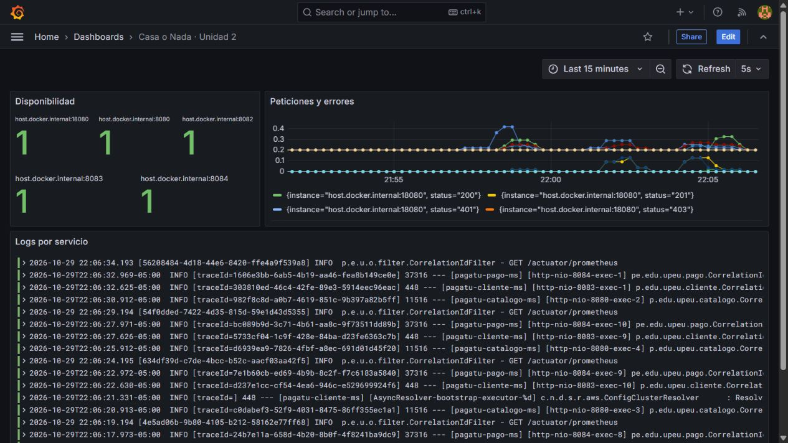

# S10 · Observabilidad

**Jannys Graciela Navarro Acrota** · Tarea personal de Sistemas Distribuidos.

Grupo de referencia: Casa o Nada. Esta documentación corresponde al avance individual, no al informe grupal oficial.

## Trabajo realizado

Se configuraron health checks, métricas con Prometheus, logs en Loki y un tablero en Grafana. El identificador X-Trace-ID permite seguir una operación entre servicios.

## Evidencia

El tablero muestra los cinco servicios disponibles, tasas de peticiones y logs reales. Se verificó además la propagación del identificador de una orden entre órdenes, catálogo, pagos y cliente.

[Extracto de correlación entre servicios](../evidencias/trazabilidad.txt).

## Explicación breve

Las métricas muestran cuándo cambia el comportamiento; los logs ayudan a explicar por qué. Liveness indica si el proceso sigue vivo y readiness si puede atender con sus dependencias. La configuración existe; no se incluye aquí una prueba adicional con la base de datos apagada.
