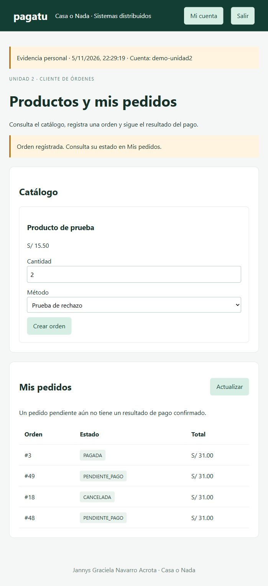
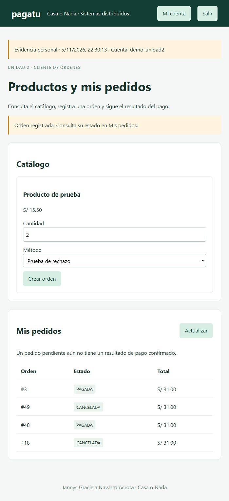
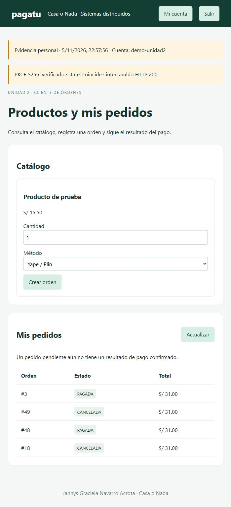

# S11 · Integración Angular con Keycloak

**Estudiante:** Jannys Graciela Navarro Acrota

**Equipo de referencia:** 09 · Casa o Nada

**Entrega:** tarea personal sobre la base Pagatu; implementación individual y verificación local.

**Repositorio:** [https://github.com/Stephmarc/Tareas-Distribuidas](https://github.com/Stephmarc/Tareas-Distribuidas)

**Guía docente:** [Actividad y estructura](https://262dist.github.io/pagatu/sesiones/S11_Integracion_Cliente_Frontend_Angular_Keycloak/#4-crea-actividad-autonoma)

[Descargar informe PDF](S11_Equipo09_NavarroJannys.pdf)

## Qué se ejecutó

Pruebas realizadas el 5 de noviembre de 2026, hora de Lima. Las fechas ISO de los reportes usan UTC y por eso pueden indicar 6 de noviembre. Los IDs, estados y códigos que siguen proceden de las respuestas originales, no de resultados inventados.

## 1. Migración a Keycloak

El estado final usa el realm pagatu y roles ADMIN/CLIENTE de Keycloak. Auth propio se conserva para estudiar S07, pero la SPA y los Resource Servers finales confían en Keycloak. El frontend muestra el usuario real demo-unidad2.

## 2. Authorization Code y PKCE

Se completó un nuevo login real desde Angular con Authorization Code y PKCE S256. El modo de evidencia comparó el state recibido con el enviado y SHA-256(code_verifier) con code_challenge: ambos true; el intercambio de token respondió HTTP 200. Solo se registran booleanos, fecha y código HTTP. La cuenta cliente es pública, sin client_secret y con Direct access grants desactivado.

## 3. Estado todavía no resuelto

La SPA crea una orden por el Gateway 18080 y muestra PENDIENTE_PAGO antes del resultado Kafka. Realiza polling cada dos segundos, sin solapar peticiones, con límite de intentos y limpieza del temporizador al destruir el componente.

## 4. Camino feliz y rechazo

Se detuvo pago-ms y se crearon desde Angular las órdenes 48 y 49 por 31.00. La captura inicial muestra ambas PENDIENTE_PAGO. Después de arrancar pago, la misma página cambió por polling a 48 PAGADA y 49 CANCELADA, sin pulsar Actualizar. Una consulta SQL posterior confirma los dos estados y el mismo clienteId.

## Código incorporado y su función

### `main.ts`

[Ver archivo y líneas en GitHub](https://github.com/Stephmarc/Tareas-Distribuidas/blob/main/clients/pagatu-frontend/src/main.ts#L1)

```typescript
  1 import {Component,signal,OnDestroy} from '@angular/core';
  2 import {bootstrapApplication} from '@angular/platform-browser';
  3 import Keycloak from 'keycloak-js';
  4 import {rememberAuthorization,observePkce,PkceProof} from './pkce-evidence';
  5 type Producto={id:number,nombre:string,precio:number};
  6 type Orden={id:number,estado:string,total:number|null,detalles:unknown[]};
  7 @Component({selector:'app-root',standalone:true,template:`
  8 <header><strong>pagatu</strong><span>Casa o Nada · Sistemas distribuidos</span><button (click)="login()">{{authenticated()?'Mi cuenta':'Ingresar'}}</button>@if(authenticated()){<button (click)="logout()">Salir</button>}</header>
  9 <main>@if(evidence){<p class="notice">Evidencia personal · {{clock()}} · Cuenta: {{username()}}</p>@if(pkceProof()){<p class="notice">PKCE S256: {{pkceProof()!.verifierS256Coincide?'verificado':'no coincide'}} · state: {{pkceProof()!.stateCoincide?'coincide':'no coincide'}} · intercambio HTTP {{pkceProof()!.http}}</p>}}<p class="eyebrow">UNIDAD 2 · CLIENTE DE ÓRDENES</p><h1>Productos y mis pedidos</h1><p>Consulta el catálogo, registra una orden y sigue el resultado del pago.</p>
 10 @if(message()){<p class="notice" role="status">{{message()}}</p>}
 11 @if(!authenticated()){<section><h2>Inicia sesión para continuar</h2><p>Tu cuenta permite consultar tus órdenes y su estado de pago.</p><button (click)="login()">Ingresar con Keycloak</button></section>}
 12 @if(authenticated()){
 13 <section><h2>Catálogo</h2><div class="products">@for(p of products();track p.id){<article><h3>{{p.nombre}}</h3><p>S/ {{p.precio.toFixed(2)}}</p><label>Cantidad <input #cantidad type="number" min="1" max="100" value="1"></label><label>Método <select #metodo><option value="YAPE_PLIN">Yape / Plin</option><option value="RECHAZADO">Prueba de rechazo</option></select></label><button [disabled]="busy()" (click)="create(p.id,+cantidad.value,metodo.value)">Crear orden</button></article>}</div></section>
 14 <section><div class="row"><h2>Mis pedidos</h2><button (click)="loadOrders()">Actualizar</button></div><p>Un pedido pendiente aún no tiene un resultado de pago confirmado.</p><table><thead><tr><th>Orden</th><th>Estado</th><th>Total</th></tr></thead><tbody>@for(o of orders();track o.id){<tr><td>#{{o.id}}</td><td><span class="badge">{{o.estado}}</span></td><td>{{o.total===null?'Por confirmar':'S/ '+o.total.toFixed(2)}}</td></tr>}@empty{<tr><td colspan="3">Todavía no hay pedidos.</td></tr>}</tbody></table></section>}
 15 </main><footer>Jannys Graciela Navarro Acrota · Casa o Nada</footer>`})
 16 class App implements OnDestroy{
 17  pkceProof=signal<PkceProof|null>(null);evidence=new URLSearchParams(location.search).has('evidencia');clock=signal(new Date().toLocaleString('es-PE',{timeZone:'America/Lima',hour12:false}));username=signal('Sin sesión');private clockTimer=setInterval(()=>this.clock.set(new Date().toLocaleString('es-PE',{timeZone:'America/Lima',hour12:false})),1000);
 18  authenticated=signal(false);products=signal<Producto[]>([]);orders=signal<Orden[]>([]);message=signal('');busy=signal(false);
 19  private keycloak=new Keycloak({url:'http://localhost:18090',realm:'pagatu',clientId:'pagatu-frontend'});
 20  private timer:ReturnType<typeof setInterval>|undefined;private attempts=0;private polling=false;
 21  constructor(){if(this.evidence)observePkce(proof=>this.pkceProof.set(proof));this.keycloak.init({onLoad:'check-sso',pkceMethod:'S256',checkLoginIframe:false}).then(async ok=>{this.authenticated.set(ok);this.username.set(this.keycloak.tokenParsed?.['preferred_username']||'Sin sesión');if(ok){await this.loadProducts();await this.loadOrders();}}).catch(()=>this.message.set('No se pudo conectar con el servicio de acceso. Comprueba que Keycloak esté iniciado.'));}
 22  async login(){if(this.evidence){const url=await this.keycloak.createLoginUrl({redirectUri:location.origin+'/?evidencia=1',scope:'openid'});rememberAuthorization(url);location.assign(url);return;}return this.keycloak.login({redirectUri:location.origin,scope:'openid'});}
 23  logout(){return this.keycloak.logout({redirectUri:location.origin+(this.evidence?'/?evidencia=1':'')});}
 24  private async api<T>(url:string,options:RequestInit={}):Promise<T>{await this.keycloak.updateToken(30);const response=await fetch('http://localhost:18080/api/v1/'+url,{...options,headers:{'Content-Type':'application/json',Authorization:'Bearer '+this.keycloak.token}});if(!response.ok)throw new Error('La operación respondió HTTP '+response.status);return response.json() as Promise<T>;}
 25  async loadProducts(){try{this.products.set(await this.api<Producto[]>('productos'));}catch(e){this.message.set(String(e));}}
 26  async create(id:number,cantidad:number,metodoPago:string){if(this.busy()||!Number.isInteger(cantidad)||cantidad<1){return;}this.busy.set(true);try{const o=await this.api<Orden>('ordenes',{method:'POST',body:JSON.stringify({metodoPago,detalles:[{idProducto:id,cantidad}]})});this.message.set(o.estado==='CARRITO'?'Orden guardada. El catálogo no confirmó los precios.':'Orden registrada. Consulta su estado en Mis pedidos.');await this.loadOrders();}catch(e){this.message.set(String(e));}finally{this.busy.set(false);}}
 27  async loadOrders(){try{this.orders.set(await this.api<Orden[]>('ordenes'));if(this.orders().some(o=>o.estado==='PENDIENTE_PAGO')){if(!this.timer){this.attempts=0;this.timer=setInterval(()=>{if(this.polling)return;if(++this.attempts>120){this.stop();this.message.set('El pago sigue pendiente. Puedes volver a consultar más tarde.');return;}this.polling=true;this.loadOrders().finally(()=>this.polling=false);},2000);}}else{this.stop();}}catch(e){this.message.set(String(e));this.stop();}}
 28  private stop(){if(this.timer)clearInterval(this.timer);this.timer=undefined;}
 29  ngOnDestroy(){this.stop();clearInterval(this.clockTimer);}
 30 }
 31 bootstrapApplication(App).catch(console.error);
```

### `pkce-evidence.ts`

[Ver archivo y líneas en GitHub](https://github.com/Stephmarc/Tareas-Distribuidas/blob/main/clients/pagatu-frontend/src/pkce-evidence.ts#L1)

```typescript
  1 // Diagnostic mode observes the real exchange; it never stores tokens or code_verifier.
  2 export type PkceProof={stateCoincide:boolean,verifierS256Coincide:boolean,http:number,fecha:string};
  3 const key='pagatu-evidence-oauth';
  4 export function rememberAuthorization(url:string){
  5  const u=new URL(url);
  6  sessionStorage.setItem(key,JSON.stringify({state:u.searchParams.get('state'),challenge:u.searchParams.get('code_challenge')}));
  7 }
  8 export function observePkce(done:(proof:PkceProof)=>void){
  9  const saved=sessionStorage.getItem(key);if(!saved)return;
 10  const expected=JSON.parse(saved) as {state:string,challenge:string};
 11  const returnedState=new URLSearchParams(location.hash.slice(1)).get('state');
 12  const original=window.fetch.bind(window);
 13  window.fetch=async(input:RequestInfo|URL,init?:RequestInit)=>{
 14   const url=typeof input==='string'?input:input instanceof URL?input.href:input.url;
 15   const body=init?.body;
 16   if(url==='http://localhost:18090/realms/pagatu/protocol/openid-connect/token'&&body instanceof URLSearchParams&&body.get('grant_type')==='authorization_code'){
 17    window.fetch=original;
 18    const verifier=body.get('code_verifier')||'';
 19    const digest=new Uint8Array(await crypto.subtle.digest('SHA-256',new TextEncoder().encode(verifier)));
 20    const challenge=btoa(String.fromCharCode(...digest)).replace(/\+/g,'-').replace(/\//g,'_').replace(/=+$/,'');
 21    const response=await original(input,init);
 22    const proof={stateCoincide:returnedState===expected.state,verifierS256Coincide:!!verifier&&challenge===expected.challenge,http:response.status,fecha:new Date().toISOString()};
 23    sessionStorage.removeItem(key);done(proof);console.info('PKCE_EVIDENCE '+JSON.stringify(proof));
 24    return response;
 25   }
 26   return original(input,init);
 27  };
 28 }
```

## Comandos ejecutados y resultados originales

Los `.txt` son transcripts originales de PowerShell. Las capturas que los muestran en VS Code son vistas del archivo original, no fotografías de una ventana CMD. Los JSON conservan requests, respuestas, estados y trazas.

```powershell
node scripts/Verify-Frontend.cjs
```

- [Salida original: s11.json](assets/s11.json)
- [Salida original: s11-pkce.json](assets/s11-pkce.json)

### Respuesta original completa

```json
{
  "sesion": "S11",
  "fecha": "2026-11-06T03:31:43.079Z",
  "usuarioWindows": "grace",
  "cuentaFrontend": "demo-unidad2",
  "cliente": {
    "clientId": "pagatu-frontend",
    "publicClient": true,
    "standardFlowEnabled": true,
    "directAccessGrantsEnabled": false,
    "pkce": "S256",
    "redirectUris": [
      "http://localhost:4200/*"
    ]
  },
  "pasos": [
    "Inicio de sesion real con Keycloak: Authorization Code, state y code_challenge_method=S256 visibles en URL de autorizacion.",
    "Pago detenido: UI crea ordenes 48 y 49 y muestra PENDIENTE_PAGO.",
    "Pago recuperado: polling de 2 segundos actualiza 48 PAGADA y 49 CANCELADA sin pulsar Actualizar."
  ],
  "consulta": "SELECT id,cliente_id,estado,total FROM ordenes WHERE id IN (48,49) ORDER BY id",
  "filas": "48|bbd5e8a1-00fd-4b2f-ace7-0d1df66f8968|PAGADA|31.00\n49|bbd5e8a1-00fd-4b2f-ace7-0d1df66f8968|CANCELADA|31.00",
  "resultado": "APROBADO",
  "limite": "No se publica el JWT ni el code_verifier; se comparó SHA-256(verifier) con el challenge y se registraron únicamente booleanos y código HTTP.",
  "pkceComprobadoEnNavegador": {
    "stateCoincide": true,
    "verifierS256Coincide": true,
    "http": 200,
    "fecha": "2026-11-06T03:57:31.269Z"
  }
}
```

## Capturas reales

Las imágenes se conservan completas, sin superponer resultados ni modificar fechas. El reloj de VS Code es una extensión local que lee la hora del equipo; el modo `?evidencia=1` de Angular muestra la hora real y el usuario autenticado. Las vistas web de Kafka/Grafana son complementarias y no incluyen por sí solas el reloj de Windows.



*Angular con pago-ms detenido: órdenes 48 y 49 PENDIENTE_PAGO. Hora real y cuenta demo-unidad2 visibles.. Captura íntegra de la vista real; consultar la salida original para los detalles completos.*



*La misma página después de recuperar pago-ms: 48 PAGADA y 49 CANCELADA, recibidas por polling sin pulsar Actualizar.. Captura íntegra de la vista real; consultar la salida original para los detalles completos.*



*Login real: state coincide, SHA-256 del verifier coincide con el challenge y el intercambio HTTP responde 200. No se muestran tokens ni verificadores.. Captura íntegra de la vista real; consultar la salida original para los detalles completos.*

## Error o hallazgo real

Durante las pruebas hubo un catálogo temporalmente vacío hasta completar la carga asíncrona tras recuperar servicios. La interfaz conserva la distinción entre sin resultados, error y pago pendiente. No presenta una creación HTTP 201 como pago completado.

## Reflexión técnica

La respuesta de creación confirma la orden local, no el resultado del pago.
Por eso la interfaz mantiene PENDIENTE_PAGO sin anunciar éxito definitivo.
El polling consulta el estado autoritativo por el Gateway cada dos segundos.
La UI termina la espera al recibir PAGADA o CANCELADA.
El límite de intentos evita consultar indefinidamente si no llega el evento.
PKCE permite una SPA pública sin almacenar un client_secret.
sub identifica al comprador; el precio y el resultado del pago los decide el backend.

## Anexo · Feedback de la sesión

**Lo completa la estudiante.** Estas respuestas describen tu experiencia en clase; no se inventan ni se califica tu esfuerzo automáticamente. En el PDF hay campos editables.

1. ¿Cuál es el aprendizaje más importante que te llevas de la clase de hoy?

   Respuesta: ______________________________

2. ¿Qué punto de la clase te resultó más confuso o te dejó con dudas?

   Respuesta: ______________________________

3. ¿Tienes alguna pregunta para la siguiente clase?

   Respuesta: ______________________________

4. Nivel de comprensión: Entendido / Más o menos / Necesito ayuda.

   Respuesta: ______________________________

5. ¿Cómo puede ayudarte el docente a comprender mejor el tema?

   Respuesta: ______________________________

6. Participación: Muy comprometido/a / Comprometido/a / Poco comprometido/a.

   Respuesta: ______________________________

7. Satisfacción con la clase: 1 a 10.

   Respuesta: ______________________________

## Alcance y límites

Este informe documenta la tarea personal sobre Pagatu. La guía del docente también exige adaptar actividades al Proyecto Sello del equipo: la entrega grupal CASAS es independiente y no se presenta aquí como si fuera esta implementación. No se atribuye una defensa oral ni un resultado de evaluación que no se haya realizado.
