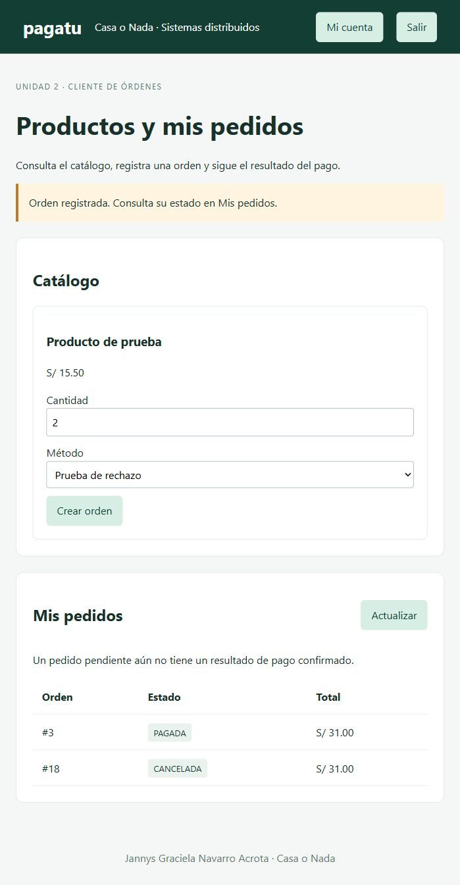

# S11 · Cliente Angular con Keycloak

**Jannys Graciela Navarro Acrota** · Tarea personal de Sistemas Distribuidos.

Grupo de referencia: Casa o Nada. Esta documentación corresponde al avance individual, no al informe grupal oficial.

## Trabajo realizado

Se construyó una interfaz simple para consultar productos, crear órdenes y ver mis pedidos. El acceso utiliza **Authorization Code + PKCE S256**, sin client secret en el navegador.

## Prueba desde la interfaz

Con la cuenta técnica **demo-unidad2**, la orden **3** terminó PAGADA y la **18** CANCELADA, ambas por **S/ 31.00**. Los estados cambiaron mediante polling, sin pulsar Actualizar ni recargar la página.

El servidor filtra las órdenes por el usuario autenticado. La interfaz no envía precio, total ni identidad del cliente.

## Explicación breve

Una respuesta 201 confirma que la orden fue creada, pero el pago se resuelve después. Por eso la pantalla distingue pendiente, pagada y cancelada.
