# S01 · Construcción de un servicio base para un sistema distribuido

## Evidencia individual — `pagatu-orden-ms`

### Datos del estudiante

| Campo | Información |
|---|---|
| **Nombre** | Jannys Graciela Navarro Acrota |
| **Equipo** | Sin equipo :( |
| **Sesión** | S01 - Construcción de un servicio base para un sistema distribuido |
| **Rol o aporte realizado** | Replicación autónoma del patrón de `pagatu-catalogo-ms` en `pagatu-orden-ms`. |
| **Link de GitHub** | https://github.com/Stephmarc |

> **Actividad:** replicación autónoma del patrón de `pagatu-catalogo-ms` en otro microservicio del dominio, `orden-ms`.

## 1. Resumen de la actividad

Se construyó y verificó `pagatu-orden-ms` como microservicio independiente del dominio de órdenes. La evidencia cubre persistencia con PostgreSQL y Flyway, ejecución con Maven Wrapper, API REST, Swagger, Actuator, pruebas CRUD, dos instancias en DEV y una prueba adicional de producción local con Docker.

## 2. Evidencia técnica

Cada captura se acompaña de una descripción específica que explica **qué se observa** y **por qué esa evidencia respalda el criterio de la rúbrica**.

### Bloque 1 — Microservicios correctamente delimitados según el dominio

`orden-ms` gestiona las entidades propias del dominio de órdenes, principalmente **ordenes** y **detalles_orden**. Estas responsabilidades corresponden al ciclo de una orden y sus líneas de detalle, mientras que `pagatu-catalogo-ms` mantiene categorías y productos; por ello no se mezclan las responsabilidades de ambos microservicios.

#### Evidencia 01 · Estructura inicial del proyecto

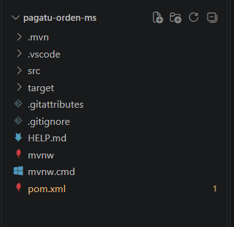

> **Descripción.** El Explorador de VS Code muestra el proyecto <b>pagatu-orden-ms</b> y sus elementos principales, incluyendo .mvn, src, target, mvnw.cmd y pom.xml. Esta captura evidencia que el trabajo autónomo se realizó sobre un microservicio independiente.

#### Evidencia 03 · Configuración de Maven y dependencias

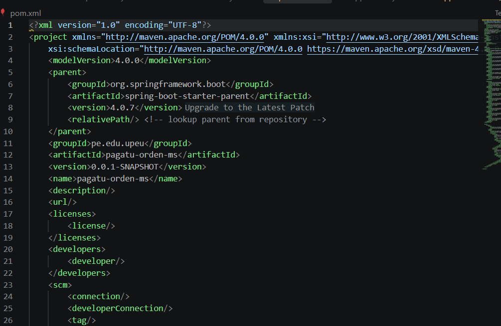

> **Descripción.** El archivo <b>pom.xml</b> abierto en VS Code muestra la configuración base del proyecto Spring Boot, incluyendo el parent de Spring Boot y la identificación del artefacto <b>pagatu-orden-ms</b>. La captura respalda la construcción del servicio sobre el stack definido para la sesión.

#### Evidencia 16 · Migración Flyway del dominio de órdenes

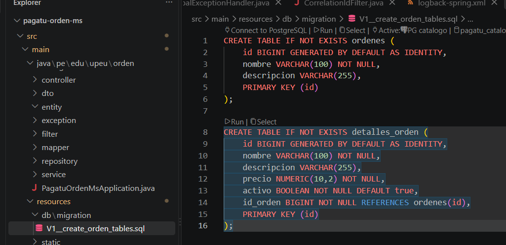

> **Descripción.** VS Code muestra el archivo <b>V1__create_orden_tables.sql</b> dentro de <b>src/main/resources/db/migration</b>. La migración define la tabla <b>ordenes</b> y forma parte del versionado del esquema de persistencia del microservicio.

### Bloque 2 — Persistencia de datos con PostgreSQL y Flyway

La persistencia del microservicio se respalda con PostgreSQL y Flyway. Las capturas muestran el contenedor DEV, la conexión a `pagatu_orden_db`, la migración `V1__create_orden_tables.sql`, las tablas creadas y consultas realizadas con `psql`.

#### Evidencia 04 · Levantamiento de PostgreSQL DEV

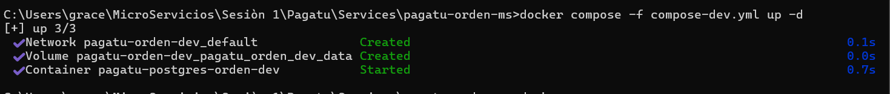

> **Descripción.** La consola muestra la ejecución de <b>docker compose -f compose-dev.yml up -d</b> y la creación de la red, volumen y contenedor <b>pagatu-postgres-orden-dev</b>. Esto evidencia que PostgreSQL DEV queda disponible antes de ejecutar la aplicación.

#### Evidencia 05 · Configuración de PostgreSQL DEV

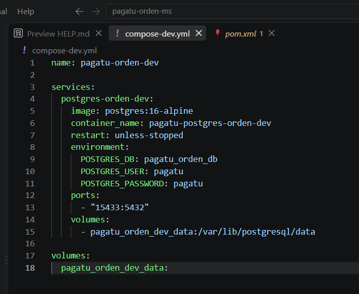

> **Descripción.** El archivo <b>compose-dev.yml</b> muestra el servicio PostgreSQL de desarrollo, su imagen <b>postgres:16-alpine</b>, el contenedor <b>pagatu-postgres-orden-dev</b>, la base <b>pagatu_orden_db</b> y el mapeo del puerto de PostgreSQL. Esta configuración permite reproducir la base de datos del microservicio.

#### Evidencia 06 · Contenedor PostgreSQL activo

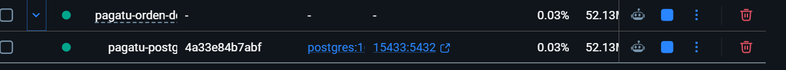

> **Descripción.** Docker Desktop muestra el contenedor PostgreSQL de órdenes en ejecución y el puerto del host mapeado hacia PostgreSQL. La evidencia complementa la consola y confirma visualmente que la infraestructura de persistencia está activa.

#### Evidencia 07 · Conexión a PostgreSQL desde cliente gráfico

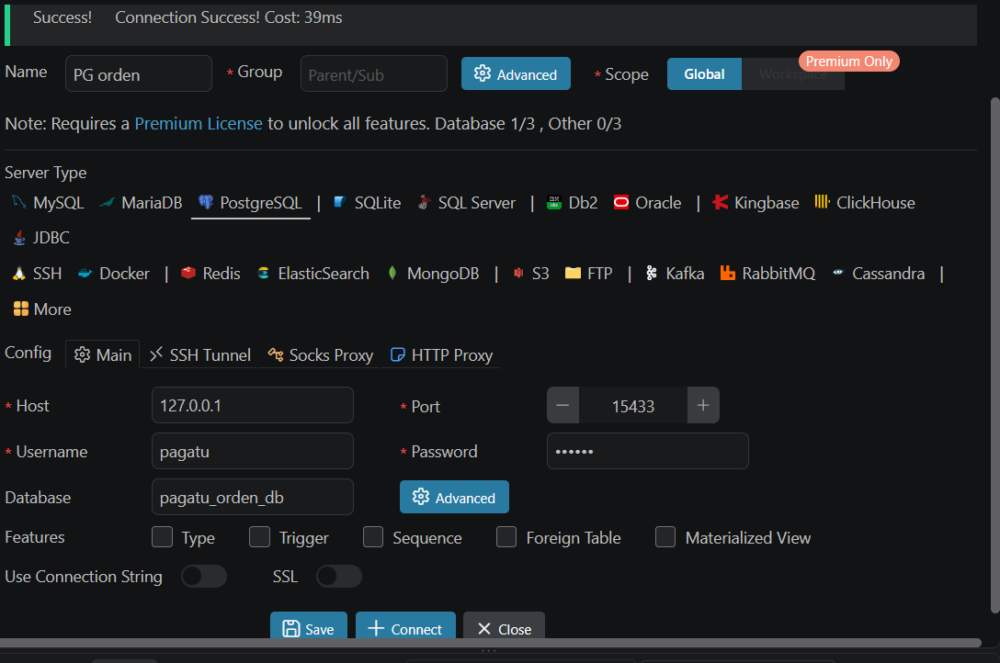

> **Descripción.** El cliente de base de datos muestra una conexión exitosa a PostgreSQL mediante <b>127.0.0.1</b>, con el puerto configurado para DEV y el usuario <b>pagatu</b>. Esto demuestra que la base del microservicio puede inspeccionarse desde una herramienta externa.

#### Evidencia 08 · Verificación de PostgreSQL con Docker y psql

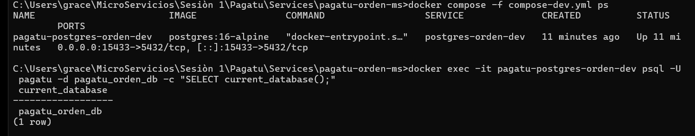

> **Descripción.** La consola muestra <b>docker compose ... ps</b> con PostgreSQL en estado <b>Up</b> y luego un <b>docker exec ... psql</b> que consulta <b>current_database()</b>, obteniendo <b>pagatu_orden_db</b>. Se verifica así tanto el contenedor como la base efectiva usada por el servicio.

#### Evidencia 16 · Migración Flyway del dominio de órdenes

> **Descripción.** VS Code muestra el archivo <b>V1__create_orden_tables.sql</b> dentro de <b>src/main/resources/db/migration</b>. La migración define la tabla <b>ordenes</b> y forma parte del versionado del esquema de persistencia del microservicio.

#### Evidencia 17 · Esquema de órdenes visible en PostgreSQL

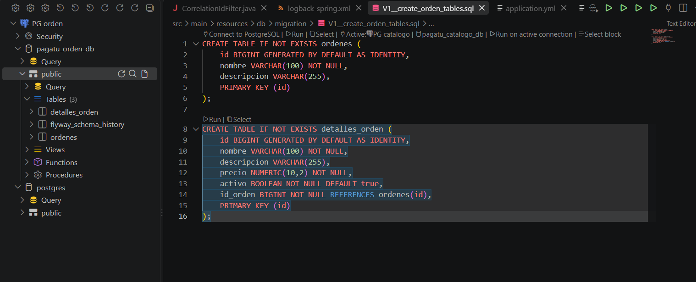

> **Descripción.** El cliente de PostgreSQL muestra la migración SQL junto con las relaciones del esquema, incluyendo <b>detalles_orden</b>, <b>flyway_schema_history</b> y <b>ordenes</b>. Esta captura relaciona el script de migración con el esquema efectivamente disponible en la base.

#### Evidencia 19 · Tablas creadas por Flyway

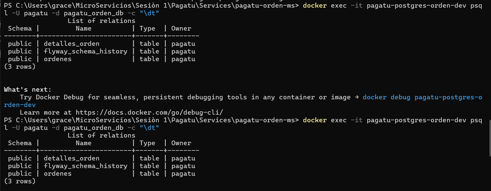

> **Descripción.** La consola ejecuta <b>\dt</b> mediante <b>psql</b> dentro del contenedor y devuelve las tablas <b>detalles_orden</b>, <b>flyway_schema_history</b> y <b>ordenes</b>. Esta es una evidencia directa de que las tablas del microservicio existen en PostgreSQL.

#### Evidencia 20 · Estructura de la tabla ordenes

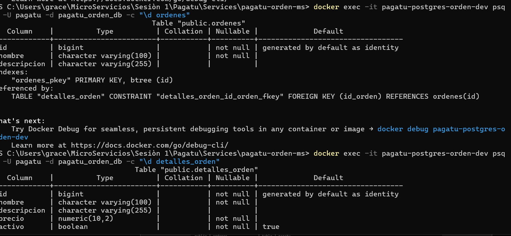

> **Descripción.** La consola ejecuta <b>\d ordenes</b> y muestra la definición de la tabla: <b>id</b>, <b>nombre</b> y <b>descripcion</b>, además de su clave primaria. Esta consulta permite verificar la estructura real creada en PostgreSQL.

### Bloque 3 — Endpoints REST funcionales y documentados

La API del dominio expone operaciones para órdenes y detalles de órdenes. Swagger documenta los controladores y PowerShell demuestra las operaciones CRUD contra `api/v1`.

#### Evidencia 12 · Endpoint temporal de saludo

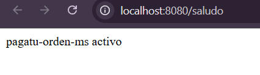

> **Descripción.** El navegador muestra <b>localhost:8080/saludo</b> y la respuesta <b>pagatu-orden-ms activo</b>. La captura confirma que la aplicación está atendiendo peticiones HTTP en el puerto 8080.

#### Evidencia 13 · Swagger / OpenAPI disponible

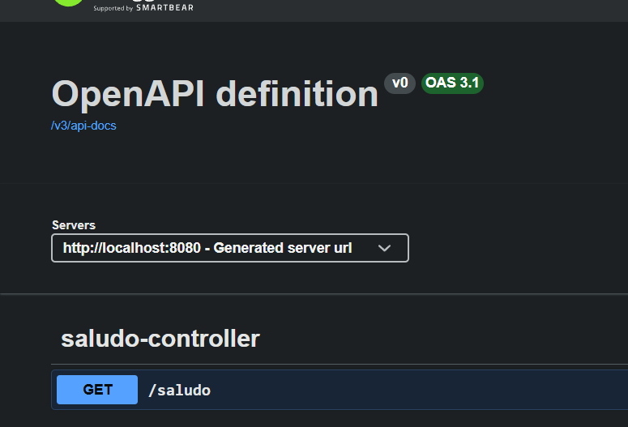

> **Descripción.** La interfaz de Swagger muestra la definición OpenAPI del servicio y el <b>saludo-controller</b> con su operación GET. Esto demuestra que la API puede ser explorada y documentada mediante Swagger en DEV.

#### Evidencia 21 · Swagger con los controladores del dominio

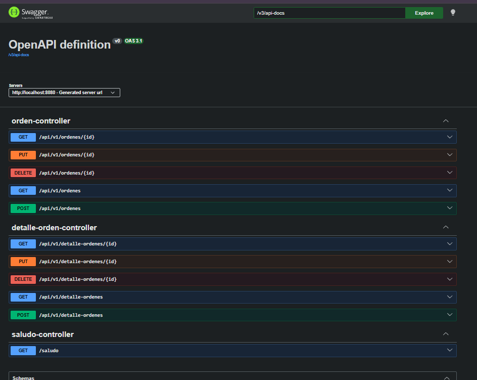

> **Descripción.** Swagger muestra los grupos <b>orden-controller</b> y <b>detalle-orden-controller</b>, junto con las rutas de órdenes y detalles de órdenes. La captura evidencia que el contrato REST del microservicio está disponible para consulta.

#### Evidencia 24 · GET de la colección de órdenes

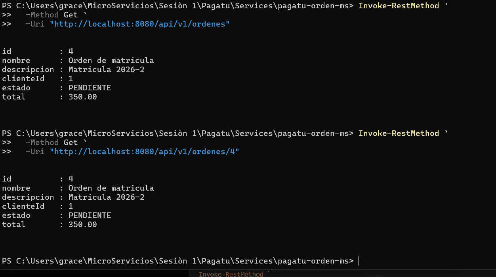

> **Descripción.** La petición GET a <b>/api/v1/ordenes</b> devuelve una orden con sus datos principales: nombre, descripción, cliente, estado y total. La captura demuestra que el endpoint de consulta de órdenes responde con datos persistidos.

#### Evidencia 25 · PUT de una orden

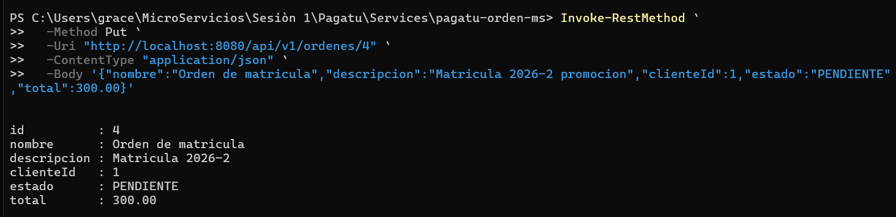

> **Descripción.** PowerShell ejecuta un <b>PUT</b> sobre <b>/api/v1/ordenes/4</b> enviando un JSON con la información actualizada. La respuesta devuelve la orden modificada, demostrando la operación de actualización del CRUD.

#### Evidencia 26 · DELETE y comprobación de 404

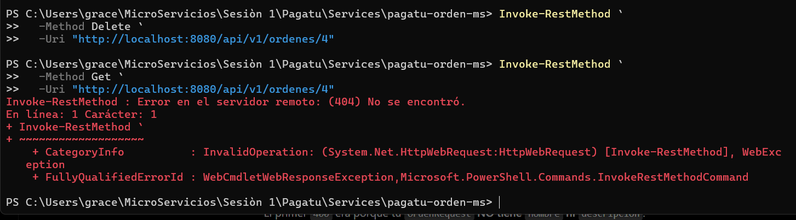

> **Descripción.** PowerShell elimina la orden mediante <b>DELETE /api/v1/ordenes/4</b> y luego intenta consultarla nuevamente. La segunda petición devuelve <b>404 No se encontró</b>, evidenciando el manejo de un recurso que ya no existe.

#### Evidencia 27 · POST de una orden

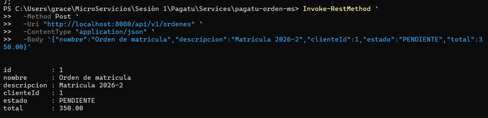

> **Descripción.** PowerShell ejecuta un <b>POST /api/v1/ordenes</b> con nombre, descripción, cliente, estado y total. La respuesta devuelve la orden creada, demostrando la operación de alta del recurso principal.

#### Evidencia 28 · POST de un detalle de orden

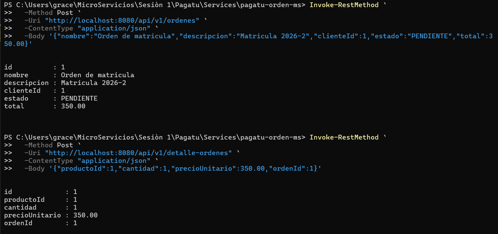

> **Descripción.** PowerShell ejecuta un <b>POST /api/v1/detalle-ordenes</b> con producto, cantidad, precio unitario y orden asociada. La respuesta muestra el detalle creado y su vínculo con la orden.

#### Evidencia 29 · GET de detalles de orden

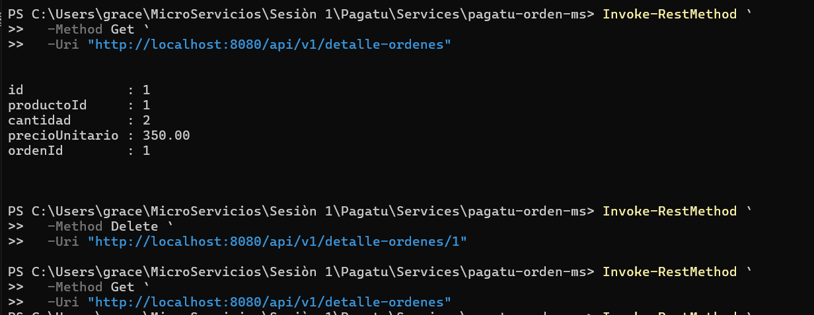

> **Descripción.** La petición GET a <b>/api/v1/detalle-ordenes</b> devuelve un detalle con <b>productoId</b>, <b>cantidad</b>, <b>precioUnitario</b> y <b>ordenId</b>. Esta captura evidencia la consulta del segundo recurso del dominio.

#### Evidencia 30 · Consulta de órdenes y creación del detalle

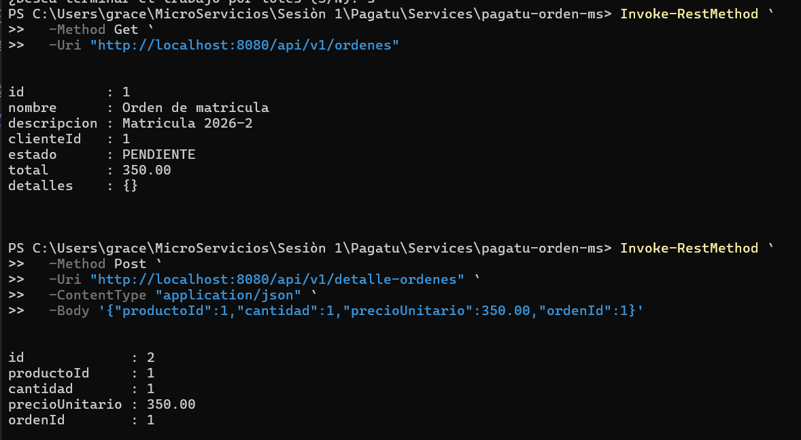

> **Descripción.** La consola primero consulta las órdenes y muestra la orden con sus datos; después ejecuta un POST para crear un detalle asociado. La captura evidencia la interacción entre los dos recursos que conforman el dominio de órdenes.

#### Evidencia 31 · Orden con su detalle asociado

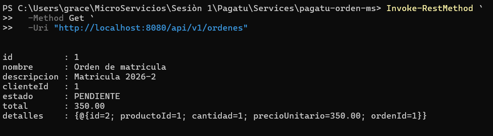

> **Descripción.** La petición GET a <b>/api/v1/ordenes</b> devuelve la orden junto con una colección <b>detalles</b> que contiene el detalle creado. Esto evidencia que la respuesta del dominio puede incluir la información relacionada de la orden.

### Bloque 4 — Ejecución y escalamiento horizontal

La ejecución DEV se valida mediante Actuator y mediante dos procesos del mismo servicio en `8080` y `8081`. Ambas instancias responden independientemente, lo que demuestra el patrón básico de escalamiento horizontal solicitado.

#### Evidencia 10 · Actuator Health desde el navegador

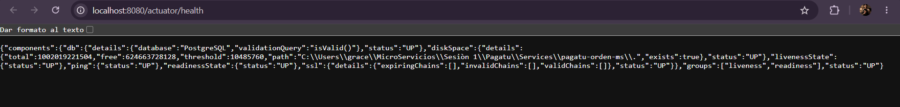

> **Descripción.** El navegador consulta <b>localhost:8080/actuator/health</b> y devuelve el estado general <b>UP</b>. La respuesta incluye componentes como db, diskSpace, livenessState, ping, readinessState y ssl, demostrando que el servicio está operativo y que la conexión con PostgreSQL está saludable.

#### Evidencia 11 · Prueba de Health y endpoint de saludo

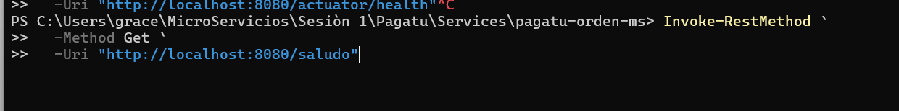

> **Descripción.** PowerShell ejecuta una consulta a <b>/actuator/health</b> y posteriormente una petición GET a <b>/saludo</b>. Esta captura forma parte de la comprobación funcional inicial del servicio después de resolver el problema de configuración.

#### Evidencia 14 · Arranque correcto de Spring Boot

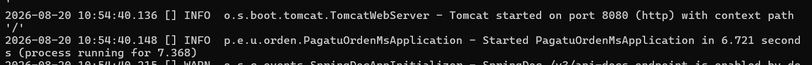

> **Descripción.** Los logs registran <b>Tomcat started on port 8080</b> y <b>Started PagatuOrdenMsApplication</b>. La evidencia demuestra que, después de corregir la configuración del ambiente, el microservicio inicia correctamente en DEV.

#### Evidencia 15 · Dos instancias en 8080 y 8081

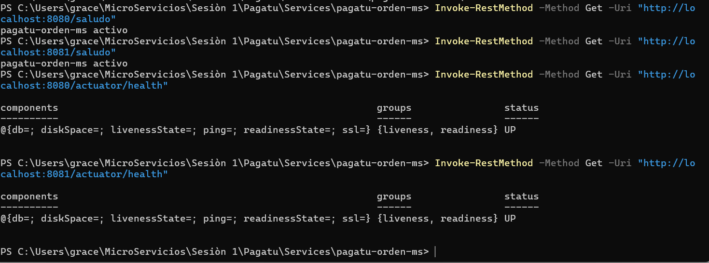

> **Descripción.** PowerShell consulta <b>/saludo</b> primero en <b>localhost:8080</b> y después en <b>localhost:8081</b>, obteniendo la misma respuesta <b>pagatu-orden-ms activo</b>. Esta es la evidencia directa del escalamiento horizontal con dos procesos del mismo microservicio.

#### Evidencia 22 · Health de la aplicación con PostgreSQL

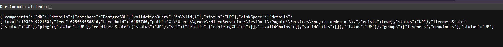

> **Descripción.** La respuesta de <b>/actuator/health</b> muestra <b>db: UP</b>, estados de liveness/readiness y estado general <b>UP</b>. Esto demuestra que la aplicación no solo está levantada, sino que puede validar su dependencia de base de datos.

#### Evidencia 23 · Health y Metrics

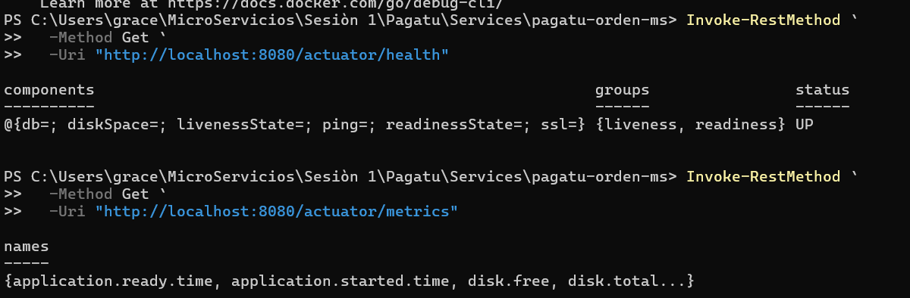

> **Descripción.** PowerShell consulta <b>/actuator/health</b> y luego <b>/actuator/metrics</b>. La evidencia demuestra la disponibilidad de los dos endpoints de observabilidad solicitados para DEV.

#### Evidencia 36 · Dos réplicas en Docker y health

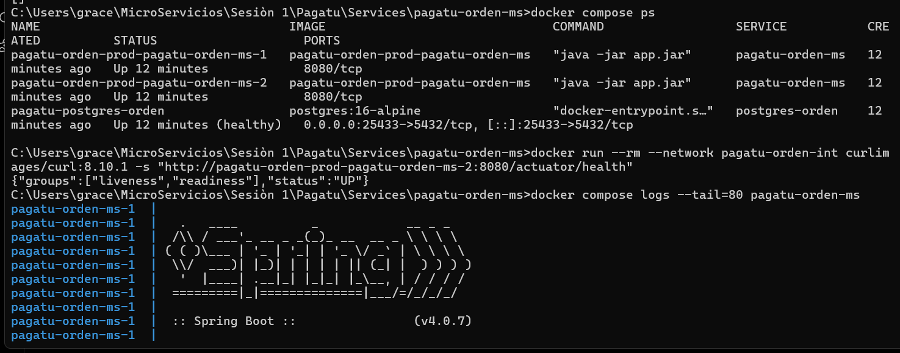

> **Descripción.** La salida de <b>docker compose ps</b> muestra dos contenedores de <b>pagatu-orden-ms</b> activos y PostgreSQL en estado <b>healthy</b>. Luego se consulta <b>/actuator/health</b> de la segunda instancia y se obtiene <b>status: UP</b>; finalmente se muestran logs del servicio. Esta captura evidencia escalamiento controlado en PROD local.

### Bloque 5 — Documentación técnica clara y reproducible

La evidencia permite reconstruir el flujo de ejecución y prueba del microservicio. Maven Wrapper, las pruebas de shell y la ejecución adicional en Docker documentan cómo repetir el trabajo sin depender de una ejecución manual dentro del IDE.

#### Evidencia 02 · Fallo inicial de arranque: DataSource

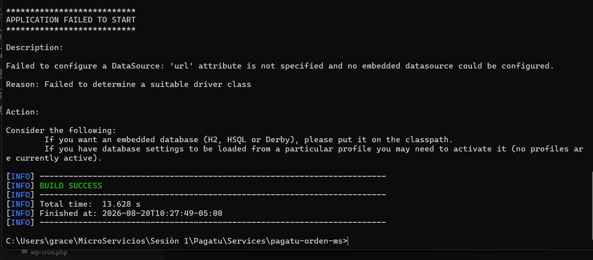

> **Descripción.** La consola muestra el mensaje <b>APPLICATION FAILED TO START</b> y el diagnóstico de Spring Boot: no se pudo configurar el DataSource porque no se había especificado la URL y no se pudo determinar un driver adecuado. Este fue un hallazgo inicial de configuración del ambiente de persistencia.

#### Evidencia 09 · Ingreso al servicio y ejecución en PowerShell

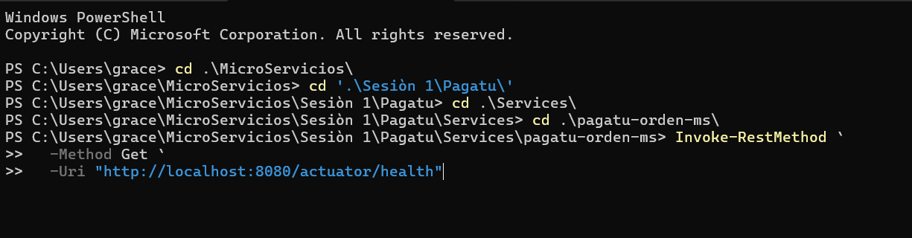

> **Descripción.** La consola muestra el recorrido hasta la carpeta <b>Services\pagatu-orden-ms</b>. Esta evidencia ubica el contexto desde el cual se ejecutan las pruebas del microservicio mediante PowerShell.

#### Evidencia 18 · Empaquetado con Maven Wrapper

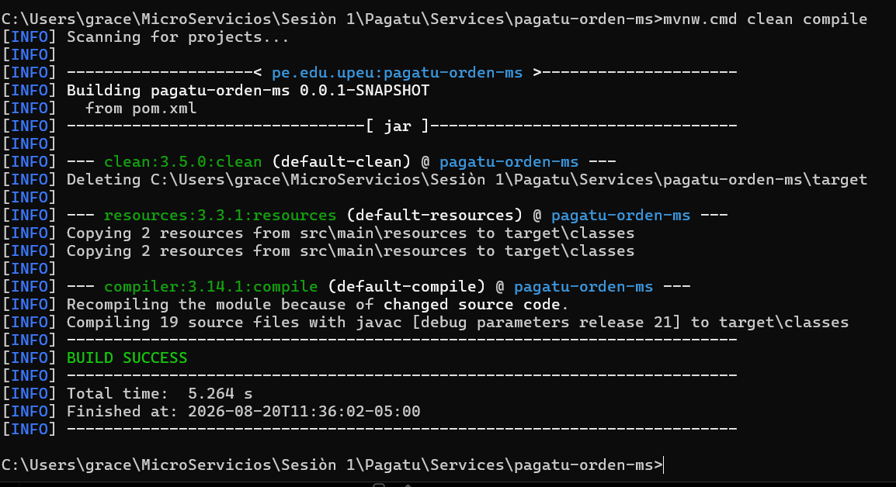

> **Descripción.** La consola muestra la ejecución de <b>.\mvnw.cmd clean package -DskipTests</b>. Maven compila el proyecto, ejecuta el ciclo de empaquetado y prepara el artefacto JAR de <b>pagatu-orden-ms</b>.

#### Evidencia 32 · CRUD en PROD local mediante red Docker

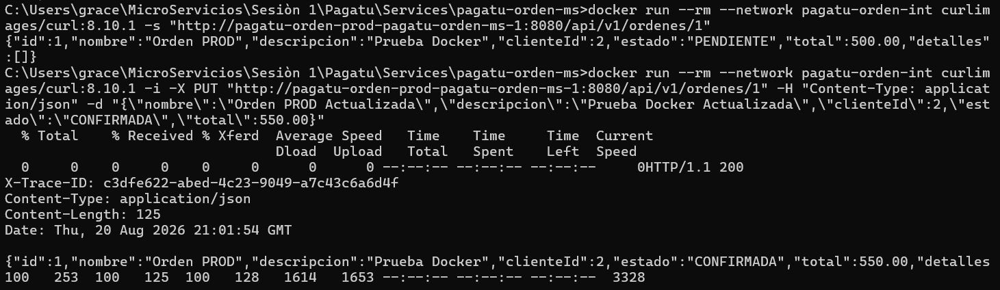

> **Descripción.** Un contenedor temporal de <b>curl</b> consulta la instancia del microservicio dentro de la red Docker y obtiene una orden. Luego ejecuta un <b>PUT</b> que devuelve <b>HTTP/1.1 200</b> y un <b>X-Trace-ID</b>, demostrando operación REST en PROD local y trazabilidad.

#### Evidencia 33 · DELETE de detalle en PROD local

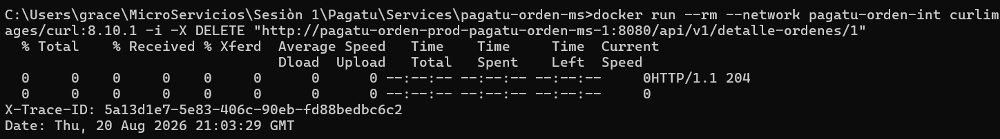

> **Descripción.** Desde un contenedor <b>curl</b> conectado a la red Docker se ejecuta <b>DELETE /api/v1/detalle-ordenes/1</b>. La respuesta es <b>HTTP/1.1 204</b> y contiene un <b>X-Trace-ID</b>, evidenciando eliminación exitosa y trazabilidad.

#### Evidencia 34 · DELETE de orden en PROD local

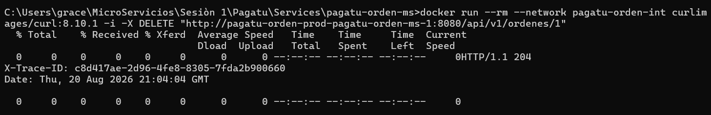

> **Descripción.** La misma red Docker se utiliza para ejecutar <b>DELETE /api/v1/ordenes/1</b>. La respuesta <b>HTTP/1.1 204</b> confirma la eliminación exitosa de la orden en el entorno de producción local.

#### Evidencia 35 · Colección de órdenes vacía después del CRUD

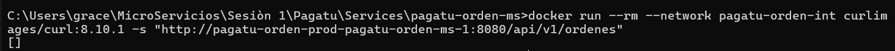

> **Descripción.** Una consulta GET a <b>/api/v1/ordenes</b> desde la red Docker devuelve <b>[]</b>. Esto confirma el estado final de la prueba CRUD después de eliminar los registros utilizados en la demostración.

## 3. Reproducción técnica

1. Levantar PostgreSQL DEV mediante `docker compose -f compose-dev.yml up -d`.
2. Verificar el contenedor `pagatu-postgres-orden-dev` con `docker compose ... ps`.
3. Comprobar la base `pagatu_orden_db` mediante `psql`.
4. Ejecutar `pagatu-orden-ms` con Maven Wrapper.
5. Verificar `/actuator/health` y `/actuator/metrics`.
6. Abrir Swagger y revisar los controladores de órdenes y detalles.
7. Probar GET, POST, PUT y DELETE por PowerShell.
8. Levantar una segunda instancia con `--server.port=8081` y comprobar `8080` y `8081`.
9. Como evidencia adicional, levantar PROD local con Docker y validar el CRUD desde la red Docker.
10. Empaquetar con `mvnw.cmd clean package -DskipTests` y verificar el JAR generado.

## 4. Error o hallazgo técnico

El primer arranque del servicio falló porque Spring Boot no pudo configurar el `DataSource`: faltaba la URL de conexión y no se encontraba un driver adecuado. El diagnóstico se obtuvo directamente del mensaje `APPLICATION FAILED TO START`. La corrección consistió en disponer de PostgreSQL DEV y su configuración antes de volver a iniciar la aplicación. Después de ello, el servicio arrancó correctamente, respondió en `/actuator/health` y permitió continuar con las pruebas REST.

Como hallazgo funcional adicional, después de eliminar una orden, una consulta posterior devolvió `404 No se encontró`. Esto confirma que el servicio distingue correctamente entre un recurso existente y uno que ya fue eliminado.

## 5. Reflexión técnica

Un microservicio debe poder ejecutarse de forma reproducible en DEV y PROD local porque ambos ambientes cumplen objetivos diferentes, pero deben conservar el mismo comportamiento esencial. En DEV, Maven Wrapper permite ejecutar y depurar el servicio directamente desde el host. En PROD local, Docker encapsula la aplicación y sus dependencias. El escalamiento horizontal permite agregar instancias sin cambiar la lógica de negocio. Por eso un microservicio no debe depender de un puerto fijo como parte de su lógica. La distribución del tráfico debe ser responsabilidad de la infraestructura, por ejemplo un Gateway o balanceador.

## 6. Preguntas de defensa

| Pregunta | Respuesta |
|---|---|
| ¿Por qué la segunda instancia usa `8081`? | Para evitar el conflicto de puerto con la instancia que ya usa `8080`. |
| ¿Qué demuestra que PostgreSQL fue usado? | Las consultas `psql`, la existencia de las tablas y el estado `db: UP` de Actuator. |
| ¿Qué aporta Flyway? | Versiona y aplica la estructura de la base mediante migraciones reproducibles. |
| ¿Cómo se prueba sin Postman? | Con PowerShell/bash, Swagger y, en PROD local, un contenedor `curl` dentro de la red Docker. |
| ¿Qué componente repartirá tráfico más adelante? | Un Gateway/balanceador, no el microservicio mediante un puerto fijo. |
| ¿Qué diferencia hay entre DEV y PROD Docker? | En DEV la aplicación corre en el host con Maven Wrapper; en PROD local corre dentro de contenedores y usa la red Docker. |

## 7. Anexo — Feedback de la sesión

### 1. ¿Cuál es el aprendizaje más importante que te llevas de la clase de hoy?
Aprendí a replicar el patrón de un microservicio completo, conectándolo a PostgreSQL con Flyway y comprobando su funcionamiento mediante REST, Swagger y Actuator.

### 2. ¿Qué punto de la clase te resultó más confuso o te dejó con dudas?
La diferencia entre ejecutar varias instancias en DEV con puertos distintos y manejar réplicas dentro de una red Docker fue el punto que más atención requirió.

### 3. ¿Tienes alguna pregunta para la siguiente clase?
¿Cómo se incorpora el Gateway para distribuir automáticamente las peticiones entre las diferentes instancias del microservicio?

### 4. Nivel de comprensión
**Entendible, sufri con algunos componentes pero pude reparar los errores gracias a la guia**

### 5. ¿Cómo puedo ayudarte a comprender mejor el tema?
Con ejemplos donde se vea el recorrido de una petición desde el cliente hasta el microservicio y posteriormente hacia varias instancias.

### 6. Autoevaluación
**Di lo mejor que pude XDDD.**

### 7. Satisfacción
**8/10.** La actividad permitió comprobar de forma práctica la construcción, persistencia, observabilidad y escalamiento de un microservicio, además que gracias a la guia entendíble pude avanzar con mas facilidad

